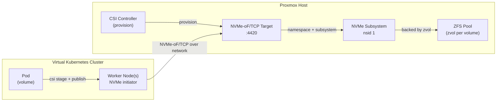

# nvmeof-csi

NVMe-oF/TCP CSI driver. Block mode. Stateless. Tested with csc (no Kubernetes).

## Who is this for

Homelab Kubernetes clusters that need real block storage, but don't want to run a heavyweight operator stack just to get it.

- **Rook** is great in every other aspect, but the resource footprint is too much for a homelab.
- **Rancher Longhorn** is not for me — it uses NFS under the hood and is about as heavy as Rook, but less feature-rich.
- **local-path-provisioner** is great, but the data only lives on a single node — lose that node, lose the data.

That's the gap I kept running into in my homelab with virtual Kubernetes clusters, so I built this.

It uses my Proxmox ZFS pool directly (no duplicated storage) and mounts the volume over the network via NVMe-oF/TCP, so different worker nodes can use the same volume — which makes maintenance scenarios (drain, node replacement) painless.



## Design
- One zvol + one NVMe subsystem per volume (nsid 1)
- Everything derived from volumeID — no metadata store

| field | derivation |
|---|---|
| volumeID | `<namespace>/<pvc>` (namespace defaults to `default`) |
| nqn | `nqn.2026-08.io.example.nvmeof:<namespace>.<pvc>` |
| dataset | `<pool>/<namespace>/<pvc>` |
| device | `/dev/nvme<n>n1`, found by NQN (never hardcoded) |

## Requirements
- Linux + kernel modules `nvmet_tcp` / `nvme_tcp`, configfs mounted
- `nvme` CLI, `zfs`/`zpool`
- Go >= 1.26 (build)
- `csc` (test only): `go install github.com/rexray/gocsi/csc@latest`

## Layout
- `cmd/nvmeof-csi` — entrypoint / gRPC server
- `pkg/csi` — Identity, Controller, Node services
- `pkg/ids` — volumeID / NQN / dataset derivation
- `pkg/nvmet` — target (configfs subsystem / namespace / port)
- `pkg/zfs` — zvol backing store
- `pkg/node` — initiator (nvme connect/disconnect, device lookup)
- `charts/nvmeof-csi` — Helm chart (CSIDriver, provisioner Deployment, node DaemonSet, StorageClass)
- `test/manual` — e2e.sh

## Build
```
go build -o bin/nvmeof-csi ./cmd/nvmeof-csi
```

## Run
```
sudo bin/nvmeof-csi \
  --socket /run/csi/nvmeof-csi.sock \
  --target-addr 192.168.1.86 \
  --port 4420 \
  --pool nvme \
  --mode all        # all | controller | node
  --node-id myhost  # optional; K8s node name for NodeGetInfo (default: os hostname)
```

### Controller on an external storage node

When the storage backend lives on a single external node (e.g. `192.168.1.207`)
and initiator mounters run on K8s worker nodes, run the driver in controller
mode on the storage node:

```
sudo ./bin/nvmeof-csi \
  --mode=controller \
  --socket=/run/csi/nvmeof-csi.sock \
  --target-addr=192.168.1.207 \
  --port=4420 \
  --pool=nvme
```

| mode | runs |
|---|---|
| `all` | controller + node (single host) |
| `controller` | target side (EnsurePort + reconcile) |
| `node` | worker host only (no target side) |

## Deploy (Kubernetes via Helm)

- `charts/nvmeof-csi/templates/csi-driver.yaml` — `CSIDriver` object
- `charts/nvmeof-csi/templates/provisioner.yaml` — external-provisioner Deployment, dials the controller over TCP
- `charts/nvmeof-csi/templates/node-daemonset.yaml` — node DaemonSet (initiator side, per worker node)

The controller is not in the chart; run it on the storage host with
`deploy/systemd/nvmeof-csi-controller.service`.

```
helm install nvmeof-csi charts/nvmeof-csi \
  --set provisioner.controllerAddr=10.0.0.100:9090 \
  --set node.targetAddr=10.0.0.100
```

## Test
```
go test ./pkg/...
sudo ./test/manual/e2e.sh
```

### Manual (csc)

```
# export PATH="$PATH:$HOME/go/bin"
alias csc="sudo $HOME/go/bin/csc --endpoint unix:///run/csi/nvmeof-csi.sock"

csc identity plugin-info

csc controller create-volume --cap SINGLE_NODE_WRITER,block --req-bytes 268435456 \
  --params csi.storage.k8s.io/pvc/namespace=default,csi.storage.k8s.io/pvc/name=vol-a vol-a

csc node stage   --staging-target-path /tmp/staging --cap SINGLE_NODE_WRITER,block default/vol-a
# Mount the disk
csc node publish --target-path /tmp/pod --staging-target-path /tmp/staging \
  --cap SINGLE_NODE_WRITER,block default/vol-a

ls -l /tmp/pod
dd if=/dev/urandom of=/tmp/orig bs=1M count=64 && dd if=/tmp/orig of=/tmp/pod \
  && dd if=/tmp/pod of=/tmp/copy && cmp /tmp/orig /tmp/copy
csc node unpublish --target-path /tmp/pod default/vol-a
csc node unstage   --staging-target-path /tmp/staging default/vol-a
csc controller delete-volume default/vol-a
```

## Scope (v1)
- block mode only (no fs/mkfs), single cluster, nsid 1
- no snapshots/clones, expansion, multipath, host ACLs
- names: `/` rejected everywhere; `.` rejected in namespace only
