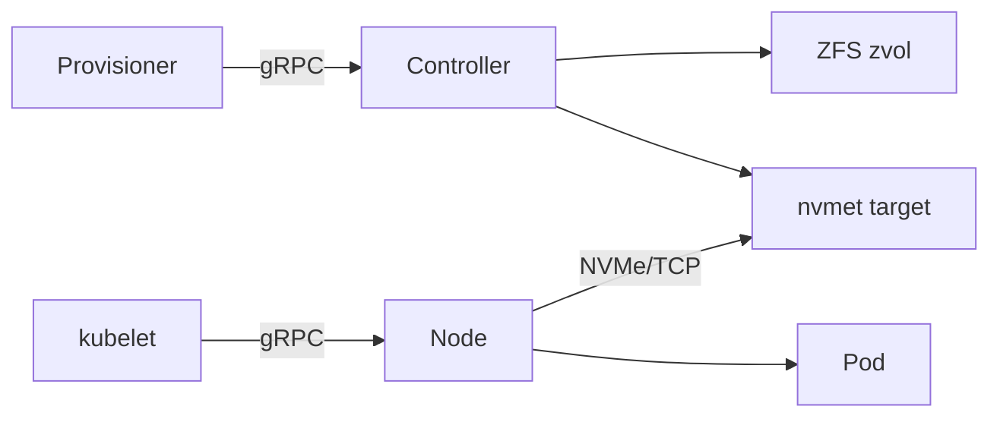
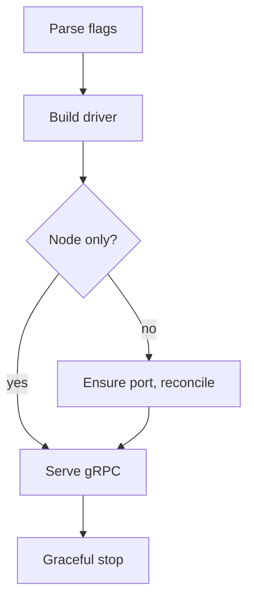

# Design: nvmeof-csi architecture

## Purpose

High-level map of the NVMe-oF/TCP CSI driver: which pieces exist, where each
runs, how one binary becomes a controller or a node process, and how every
backend name is derived from the volume ID. The per-volume flows live in
`volume-lifecycle.md`; how it is packaged and run lives in `deployment.md`.

## What the driver is

One Go binary (`cmd/nvmeof-csi`) that speaks CSI over gRPC. Stateless: no
metadata store, everything is derived from the volume ID.

| Aspect | Choice |
| --- | --- |
| Backing store | ZFS zvol per volume (`pkg/zfs`) |
| Transport | kernel nvmet target via configfs (`pkg/nvmet`) + `nvme` CLI initiator (`pkg/node`) |
| Access | `SINGLE_NODE_WRITER` only; block (raw device) or filesystem (`fsType`, default `ext4`) |
| Not supported | snapshots, clones, expansion, multi-writer |
| Attach | `ControllerPublish/Unpublish` are no-ops; the node attaches at stage time |

## Components and topology

The controller runs on the storage host (ZFS + nvmet); node processes run on
each Kubernetes worker. They never talk to each other directly — the volume
ID and the NVMe-oF/TCP connection are the only contract.

| Box | Exact component | Code |
| --- | --- | --- |
| Provisioner | `external-provisioner` sidecar, dials `--csi-address=tcp://<host>:9090` | — |
| Controller | `nvmeof-csi --mode=controller` on the target host | `pkg/csi/controller.go` |
| ZFS zvol | `<pool>/<namespace>/<pvc>`, `/dev/zvol/...` | `pkg/zfs` |
| nvmet target | `/sys/kernel/config/nvmet`, port `1`, one subsystem per volume | `pkg/nvmet` |
| kubelet | dials `/var/lib/kubelet/plugins/<pluginName>/csi.sock` | — |
| Node | `nvmeof-csi --mode=node` (DaemonSet) | `pkg/csi/node.go`, `pkg/node` |
| Pod | consumes the block device or mounted filesystem | — |

## Process startup

`main.go` parses flags, builds the `Driver`, does target-side setup unless it
is a node-only process, then serves.

| Step | Detail |
| --- | --- |
| Parse flags | `--socket` (`/run/csi/nvmeof-csi.sock`), `--listen` (`""` = off), `--target-addr` (`""` → first non-loopback IPv4), `--port` (`4420`), `--pool` (`nvme`), `--mode` (`all`), `--node-id` (`""` → `os.Hostname()`) |
| Build driver | `csi.NewDriver(Config)`; validates `--mode` ∈ `all|controller|node` (`""` → `all`) |
| Ensure port | `nvmet.EnsurePort(traddr, trsvcid)` — port `1`, `tcp`, `ipv4`; attrs written only when unset (configfs refuses rewrites on an active port) |
| Reconcile | removes subsystems carrying our NQN root whose zvol no longer exists |
| Serve gRPC | `MkdirAll` socket dir, remove stale socket, listen unix, `chmod 0770`, register services per mode; with `--listen`, the same server also serves TCP |
| Graceful stop | `SIGINT`/`SIGTERM` → `GracefulStop` on both listeners |

## Services per mode

| Mode | Identity | Controller | Node | Target setup |
| --- | --- | --- | --- | --- |
| `all` | yes | yes | yes | yes |
| `controller` | yes | yes | no | yes |
| `node` | yes | no | yes | no |

| Service | RPCs and behavior |
| --- | --- |
| Identity | `GetPluginInfo` → `com.timpa0130.nvmeof-csi` / `1.0.0`; `GetPluginCapabilities` → `CONTROLLER_SERVICE` only when the controller is served; `Probe` ready iff nvmet configfs exists |
| Controller | `CreateVolume`, `DeleteVolume`, `ValidateVolumeCapabilities`, `ListVolumes`, `GetCapacity`; advertises only `CREATE_DELETE_VOLUME`; publish/unpublish no-ops |
| Node | `NodeStage/Unstage`, `NodePublish/Unpublish`, `NodeGetInfo` (`--node-id`); advertises `STAGE_UNSTAGE_VOLUME` |

Request validation shared by controller and node (`pkg/csi/helpers.go`):
`requireVolumeID` (`InvalidArgument` when empty) and `validateCapabilities`
(≥1 capability, `block` or `mount`, `SINGLE_NODE_WRITER`). One choke point for
the access-mode policy.

## Naming: everything from the volume ID

`pkg/ids` maps the volume ID to every backend name, both ways. Determinism is
what makes create idempotent and delete/reconcile possible without state.

| Name | Format | Example |
| --- | --- | --- |
| volume ID | `<namespace>/<pvc>` (namespace defaults to `default`) | `default/vol-a` |
| NQN | `nqn.2026-08.io.example.nvmeof:<namespace>.<pvc>` | `...:default.vol-a` |
| dataset | `<pool>/<namespace>/<pvc>` | `nvme/default/vol-a` |
| zvol device | `/dev/zvol/<dataset>` | `/dev/zvol/nvme/default/vol-a` |
| initiator device | found by NQN in sysfs, never constructed | `/dev/nvme1n1` |

Reverse lookups: `ParseNQN`, `SplitVolumeID`. Validation: `ValidNamespace`
(no `/` or `.`), `ValidName` (no `/`); limits `MaxNQN`, `MaxDataset`.

## Design notes

- The gRPC TCP endpoint (`--listen`) carries the full API of its mode — for
  the controller that includes `CreateVolume`/`DeleteVolume` — with no
  transport auth. Bind it to a trusted interface.
- Capability advertisement must mirror the mode matrix; publish/unpublish are
  implemented but not advertised.
- Ownership: the driver never chowns. Pods set `securityContext.fsGroup` and
  kubelet applies it under the CSIDriver's `fsGroupPolicy: File`.
