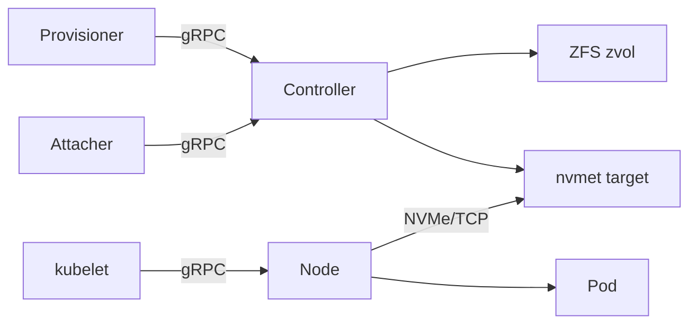
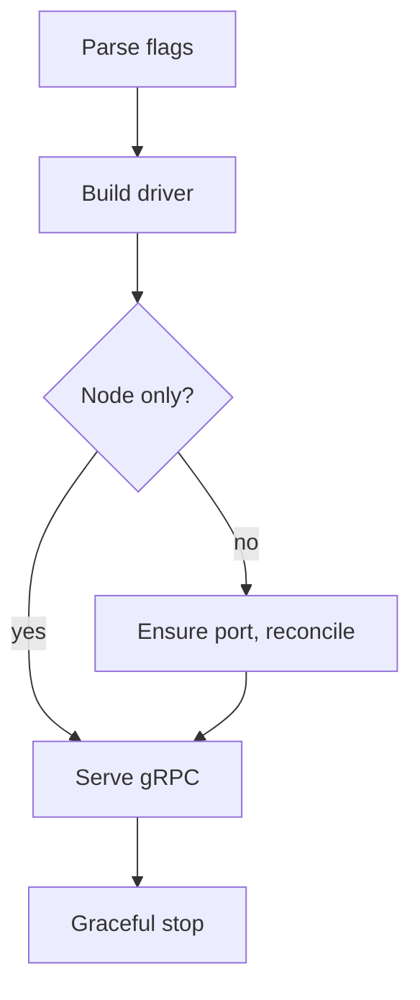

# Design: nvmeof-csi architecture

## Purpose

High-level map of the NVMe-oF/TCP CSI driver: which pieces exist, where each
runs, how one binary becomes a controller or a node process, and how every
backend name is derived from the volume ID. The per-volume flows live in
`volume-lifecycle.md`; how it is packaged and run lives in `deployment.md`.

## Glossary

| Term | Means | Not to be confused with |
| --- | --- | --- |
| Controller | `nvmeof-csi --mode=controller` on the storage host: the CSI Controller service that creates and deletes volumes (ZFS + nvmet) | csi-provisioner's own "provisioner controller" log wording (a Kubernetes control loop) |
| Provisioner | upstream `csi-provisioner` in the chart's `nvmeof-csi-provisioner` pod: watches PVCs, calls the controller's `CreateVolume`/`DeleteVolume` | the StorageClass `provisioner:` field, which is the driver name `com.timpa0130.nvmeof-csi` |
| Attacher | upstream `csi-attacher` in the same pod: watches `VolumeAttachment`s, calls the controller's `ControllerPublish`/`ControllerUnpublish` | attaching the device, which the node does at stage time |
| Node | `nvmeof-csi --mode=node` in the chart's DaemonSet: connects, stages and publishes volumes for kubelet | a Kubernetes `Node` object |
| Cluster | one Kubernetes cluster's share of a pool and target host, named by `--cluster`; scopes its datasets, NQNs and grants so several clusters can share one ZFS pool and one nvmet target | a second controller process, which is how a second cluster is actually run |

## What the driver is

One Go binary (`cmd/nvmeof-csi`) that speaks CSI over gRPC. No metadata store:
names are derived from the volume ID, and the node holding a volume is a ZFS
property on its zvol, because a target host reboot empties nvmet configfs.

| Aspect | Choice |
| --- | --- |
| Backing store | ZFS zvol per volume (`pkg/zfs`) |
| Transport | kernel nvmet target via configfs (`pkg/nvmet`) + `nvme` CLI initiator (`pkg/node`) |
| Access | `SINGLE_NODE_WRITER` only; block (raw device) or filesystem (`fsType`, default `ext4`) |
| Not supported | snapshots, clones, expansion, multi-writer |
| Attach | `ControllerPublish/Unpublish` grant and revoke the node's access on the target; the node connects at stage time |

## Components and topology

The controller runs on the storage host (ZFS + nvmet); node processes run on
each Kubernetes worker. The main setup is worker VMs on the storage host itself;
a separate NAS as the storage host is also supported. They never talk to each other directly — the volume
ID and the NVMe-oF/TCP connection are the only contract.

| Box | Exact component | Code |
| --- | --- | --- |
| Provisioner | `external-provisioner` in the chart's provisioner `Deployment`; reaches `<host>:9090` through a socat unix→TCP sidecar | — |
| Attacher | `external-attacher` in the same pod, sharing the socat sidecar | — |
| Controller | `nvmeof-csi --mode=controller` on the target host | `pkg/csi/controller.go` |
| ZFS zvol | `<pool>/<cluster>/<namespace>/<pvc>` (`<pool>/<namespace>/<pvc>` with `--cluster` empty), `/dev/zvol/...` | `pkg/zfs` |
| nvmet target | `/sys/kernel/config/nvmet`, port `--nvme-port` (default `1`), one subsystem per volume | `pkg/nvmet` |
| kubelet | dials `/var/lib/kubelet/plugins/<pluginName>/csi.sock` | — |
| Node | `nvmeof-csi --mode=node` (DaemonSet) | `pkg/csi/node.go`, `pkg/node` |
| Pod | consumes the block device or mounted filesystem | — |

## Process startup

`main.go` parses flags, builds the `Driver`, does target-side setup unless it
is a node-only process, then serves.

| Step | Detail |
| --- | --- |
| Parse flags | `--socket` (`/run/csi/nvmeof-csi.sock`), `--listen` (`""` = off), `--target-addr` (`""` → first non-loopback IPv4), `--port` (`4420`), `--pool` (`nvme`), `--cluster` (`""` = single-cluster names), `--nvme-port` (`1`), `--mode` (`all`), `--node-id` (`""` → `os.Hostname()`) |
| Build driver | `csi.NewDriver(Config)`; validates `--mode` ∈ `all|controller|node` (`""` → `all`), `--nvme-port` numeric (configfs numbers ports), `--cluster` free of `/`, `.` and `:` (`ids.ValidCluster`) |
| Ensure port | `nvmet.EnsurePort(traddr, trsvcid)` on port `--nvme-port`, `tcp`, `ipv4`; attrs written only when unset (configfs refuses rewrites on an active port) |
| Reconcile | removes subsystems carrying this cluster's NQN root whose zvol no longer exists, then rebuilds every zvol of this cluster's dataset root; foreign subsystems and datasets, sibling clusters' included, are untouched (`volume-lifecycle.md` § Recovery) |
| Serve gRPC | `MkdirAll` socket dir, remove stale socket, listen unix, `chmod 0770`, register services per mode; with `--listen`, the same server also serves TCP |
| Graceful stop | `SIGINT`/`SIGTERM` → `GracefulStop` on both listeners |

## Services per mode

| Mode | Identity | Controller | Node | Target setup |
| --- | --- | --- | --- | --- |
| `all` | yes | yes | yes | yes |
| `controller` | yes | yes | no | yes |
| `node` | yes | no | yes | no |

| Service | RPCs and behavior |
| --- | --- |
| Identity | `GetPluginInfo` → `com.timpa0130.nvmeof-csi` / `1.0.0`; `GetPluginCapabilities` → `CONTROLLER_SERVICE` only when the controller is served; `Probe` ready iff nvmet configfs exists |
| Controller | `CreateVolume`, `DeleteVolume`, `ControllerPublishVolume`, `ControllerUnpublishVolume`, `ValidateVolumeCapabilities`, `ListVolumes`, `GetCapacity`; advertises `CREATE_DELETE_VOLUME`, `PUBLISH_UNPUBLISH_VOLUME` |
| Node | `NodeStage/Unstage`, `NodePublish/Unpublish`, `NodeGetInfo` (`--node-id`); advertises `STAGE_UNSTAGE_VOLUME` |

Request validation shared by controller and node (`pkg/csi/helpers.go`):
`requireVolumeID` (`InvalidArgument` when empty) and `validateCapabilities`
(≥1 capability, `block` or `mount`, `SINGLE_NODE_WRITER`). One choke point for
the access-mode policy.

## Naming: everything from the volume ID

`pkg/ids` maps the volume ID to every backend name, both ways. Determinism is
what makes create idempotent and delete/reconcile possible without state.

The mapping is a method on `Scope{Pool, Cluster}`: the pool plus the cluster ID
(`--cluster`) decide where a volume's names land. The example column is a
deployment with `--pool=nvme --cluster=c1`; with `--cluster` empty there is no
`<cluster>` dataset component and no extra NQN label, which is the layout every
existing volume already uses.

| Name | Format | Example |
| --- | --- | --- |
| volume ID | `<namespace>/<pvc>` (namespace defaults to `default`) | `default/vol-a` |
| dataset root | `<pool>` or `<pool>/<cluster>` | `nvme/c1` |
| NQN | `<NQN root>[.<cluster>]:<namespace>.<pvc>` | `...nvmeof.c1:default.vol-a` |
| dataset | `<pool>[/<cluster>]/<namespace>/<pvc>` | `nvme/c1/default/vol-a` |
| zvol device | `/dev/zvol/<dataset>` | `/dev/zvol/nvme/c1/default/vol-a` |
| namespace UUID | UUID hashed from the NQN | `5c1e...` |
| initiator device | found by NQN in sysfs, never constructed | `/dev/nvme1n1` |

The node's identity on the target comes from the CSI node ID the same way, so
the controller and node agree on it without talking to each other:

| Name | Format | Example |
| --- | --- | --- |
| host NQN | `<NQN root>[.<cluster>].host:<node ID>` | `...nvmeof.c1.host:worker-1` |
| host ID | UUID hashed from the host NQN | `3f2a...` |

Reverse lookups: `Scope.ParseNQN`, `Scope.ParseDataset`, `SplitVolumeID`. They
report `ok=false` for anything the scope could not have named, which is what
keeps a sibling cluster's subsystems and zvols out of reconcile and
`ListVolumes`. Validation: `ValidNamespace` (no `/` or `.`), `ValidName` (no
`/`), `ValidCluster` (no `/`, `.` or `:`); limits `MaxNQN`, `MaxDataset`.

## Design notes

- The gRPC TCP endpoint (`--listen`) carries the full API of its mode — for
  the controller that includes `CreateVolume`/`DeleteVolume` — with no
  transport auth. Bind it to a trusted interface.
- Capability advertisement must mirror the mode matrix.
- Host identity is derived, not read from `/etc/nvme/hostnqn`: it needs no
  host mount or lookup, and cloned VMs sharing that file stay distinct. The
  host ID is derived too because the kernel initiator rejects one host NQN
  with two host IDs.
- Ownership: the driver never chowns. Pods set `securityContext.fsGroup` and
  kubelet applies it under the CSIDriver's `fsGroupPolicy: File`.
- A cluster ID lands in both namespaces a volume name lives in, the ZFS dataset
  path and the NQN authority, because sharing only the dataset path would still
  let two clusters name the same subsystem (and therefore the same grant, the
  same namespace UUID). It is one label under the NQN root, never a path level,
  so `ValidCluster` forbids `/`, `.` and `:` — a cluster named `a` must not be
  able to produce `...nvmeof.a.host`, which would be another cluster's host root;
  and `host` itself is reserved, being the host root of the single-cluster layout.
- `--cluster` empty means the original names, so an existing single-cluster
  deployment changes nothing; adding a cluster ID to a running deployment is a
  rename, i.e. a migration, not a config change.
- Each cluster is served by its own controller process on its own nvmet port
  (`--nvme-port`) and TCP `trsvcid` (`--port`): the kernel numbers configfs
  ports and binds `traddr:trsvcid`, so one port cannot serve two clusters.
  Capacity per cluster is a ZFS `quota` on its dataset root, which is what
  `GetCapacity` reports (see `deployment.md`).
