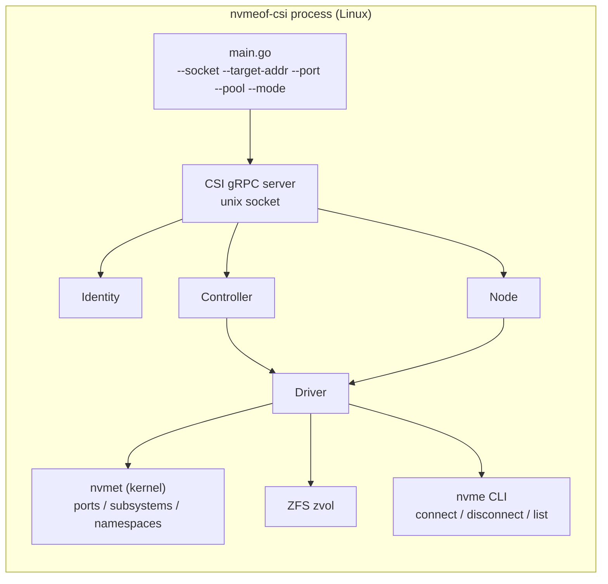
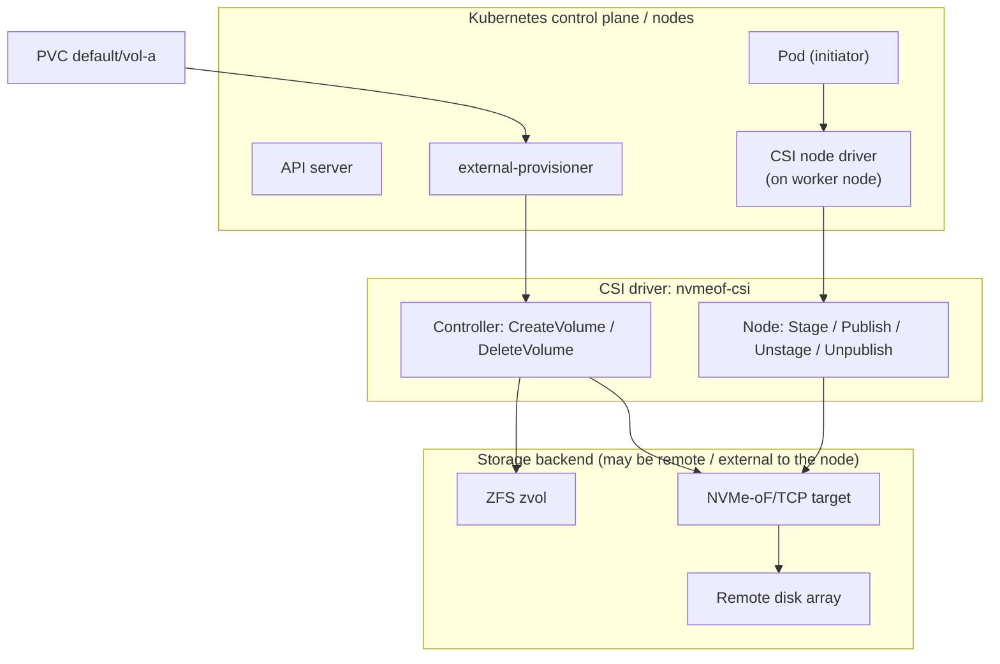
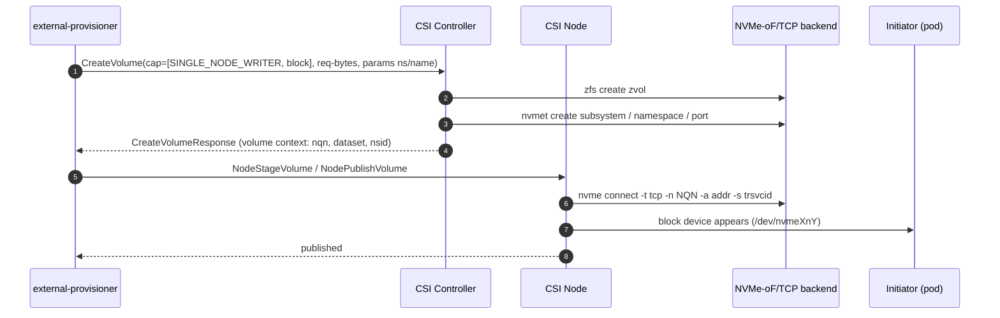

# Design: NVMe-oF/TCP CSI Driver and the External Component Flow

## Purpose

Explain how the `nvmeof-csi` driver works, how a full storage volume lifecycle
flows through it, and where the **external** Kubernetes components fit when the
backing disks are *not* directly attached to the Kubernetes node.

## 1. The CSI driver model

A CSI driver is a gRPC server that speaks the Container Storage Interface over a
Unix socket (default: `/run/csi/<plugin>.sock`).

Three service areas:

- **Identity** – plugin metadata, capabilities, probe.
- **Controller** – provisioning (`CreateVolume` / `DeleteVolume`), and
  attach (`ControllerPublishVolume` / `ControllerUnpublishVolume`).
- **Node** – staging & publishing (`NodeStageVolume`, `NodePublishVolume`,
  `NodeUnstageVolume`, `NodeUnpublishVolume`).

This repo's driver (`cmd/nvmeof-csi`) implements all three behind a single
binary, selectable via `--mode all|controller|node`.

## 2. What `nvmeof-csi` does

- Backend storage: **ZFS** zvol (`zfs create -V <bytes> -o volblocksize=16K`).
- NVMe-oF/TCP transport: **kernel nvmet** (configfs) + `nvme` CLI
  (`nvme connect -t tcp -n <nqn> -a <addr> -s <trsvcid>`).
- Semantics: `SINGLE_NODE_WRITER`; **block mode** (raw device) and
  **filesystem mode** (`fsType` created on the block device at stage time).
  No snapshot/clone/expand layer.

## 3. External counterparts

In Kubernetes the driver is consumed by *external* components:

- **external-provisioner** – watches PVCs, calls CSI controller RPCs to
  provision/delete volumes.
- **external-attacher / CSI node driver** – calls node RPCs to attach &
  publish.
- **external-snapshotter / external-resizer** – snapshots & expansion.

When the physical disks are **not directly on the Kubernetes node**, the flow
changes character: the *controller* provisions the remote backend (ZFS zvol +
NVMe-oF subsystem), and the *node* performs the initiator connection over
NVMe-oF/TCP.

## 4. Design diagrams

### 4.1 Driver internals

### 4.2 Full PV lifecycle with external components

### 4.3 Sequence: provision + publish when storage is external

## 5. The "disks not on the node" case

- Controller provisions the zvol on the backend (ZFS) and exposes it as an
  NVMe-oF/TCP subsystem/Namespace/Port.
- Node driver attaches the initiator over TCP; block volumes are bind-mounted
  as the raw device, filesystem volumes are `mkfs`'d (if needed) and mounted
  at stage time, then bind-mounted into the pod.
- The controller never needs to "know" about the node's local disks; the node
  handles the local attach.

## 6. Observations from implementation review

- Driver builds cleanly; manual e2e flow exists (`test/manual/e2e.sh`).
- Capability advertisement vs. implemented RPCs should be kept in sync
  (identity: controller capability advertised for modes serving the
  controller; node: stage/unstage advertised via NodeGetCapabilities,
  publish/unpublish implemented).
- `ControllerPublishVolume`/`ControllerUnpublishVolume` are no-ops here while
  node publish does the real work — an architectural simplification worth
  documenting.
