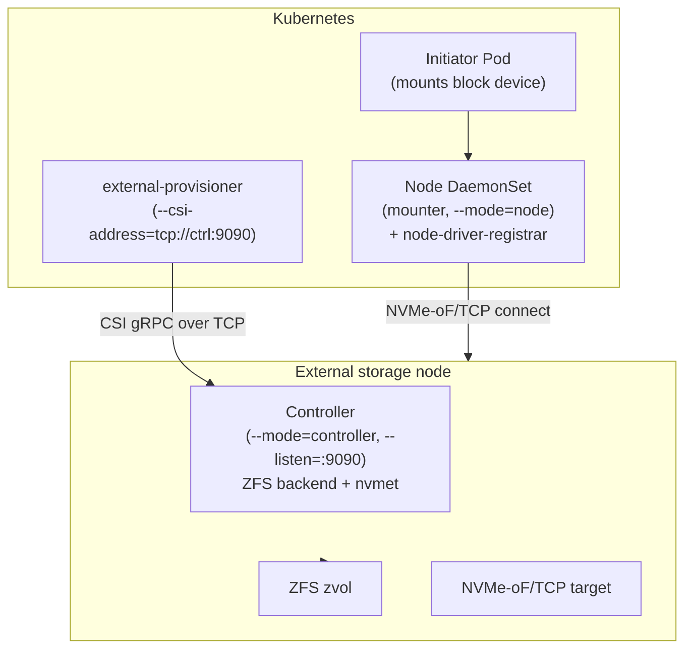

# Design: Helm chart for nvmeof-csi

## Purpose

`charts/nvmeof-csi` — Helm chart that renders the Kubernetes deployment
artifacts for the NVMe-oF/TCP CSI driver: the `CSIDriver` object, the controller
`Deployment` (storage backend side), and the node `DaemonSet` (initiator side).

## Components

- `Chart.yaml` — chart metadata (`name: nvmeof-csi`, `version: 0.1.0`).
- `values.yaml` — defaults: image (`repository`, `tag`, `pullPolicy`), `csi`
  (`pluginName`, `pluginVersion`), `storageClass` (`name`), `controller`
  (`enabled`, `replicaCount`, `mode`, `listen`, `targetAddr`, `port`, `pool`),
  `node` (`enabled`, `mode`, `targetAddr`, `port`, `pool`).
- `templates/csi-driver.yaml` — renders the `CSIDriver` object. Its
  `metadata.name` must equal the driver's `GetPluginInfo` name
  (`csi.pluginName`) — kubelet matches drivers by that name, so the old
  `nvmeof-csi` name orphaned the object. `attachRequired: false` (no
  attacher; `ControllerPublish` is a no-op).
- `templates/controller.yaml` — renders the controller `Deployment` when
  `controller.enabled`.
- `templates/node-daemonset.yaml` — renders the node `DaemonSet` when
  `node.enabled`. The driver socket lives on the host
  (`/var/lib/kubelet/plugins/<pluginName>/csi.sock`, hostPath) so kubelet can
  dial it; a `csi-node-driver-registrar` sidecar registers the driver with
  kubelet; `/var/lib/kubelet` is mounted with `Bidirectional` mount
  propagation so driver-created mounts are visible to pods; `/dev` is mounted
  for `nvme connect` and the device nodes.
- `templates/storageclass.yaml` — renders the `StorageClass` named
  `storageClass.name` with `provisioner: csi.pluginName` (external-provisioner
  claims PVCs of classes matching the connected driver).

## Deployment topology

## Design notes

- Controller Deployment runs on the storage backend node; it provisions the
  zvol (ZFS) and serves the controller RPCs. `controller.listen` optionally
  exposes the CSI gRPC API over TCP so sidecars running inside the cluster
  (e.g. external-provisioner) can dial a controller that lives off-cluster.
- Node DaemonSet runs per K8s worker; `--mode=node`; `--node-id=$(NODE_NAME)`
  resolved via `spec.nodeName` fieldRef; NVMe-oF/TCP target from
  `node.targetAddr`.
- Storage backend may live on a single external node while mounters run on
  K8s worker nodes.

## Open questions

- Pin `image.tag` to a released version.
- Controller `nodeSelector` / node tolerations configurability.
