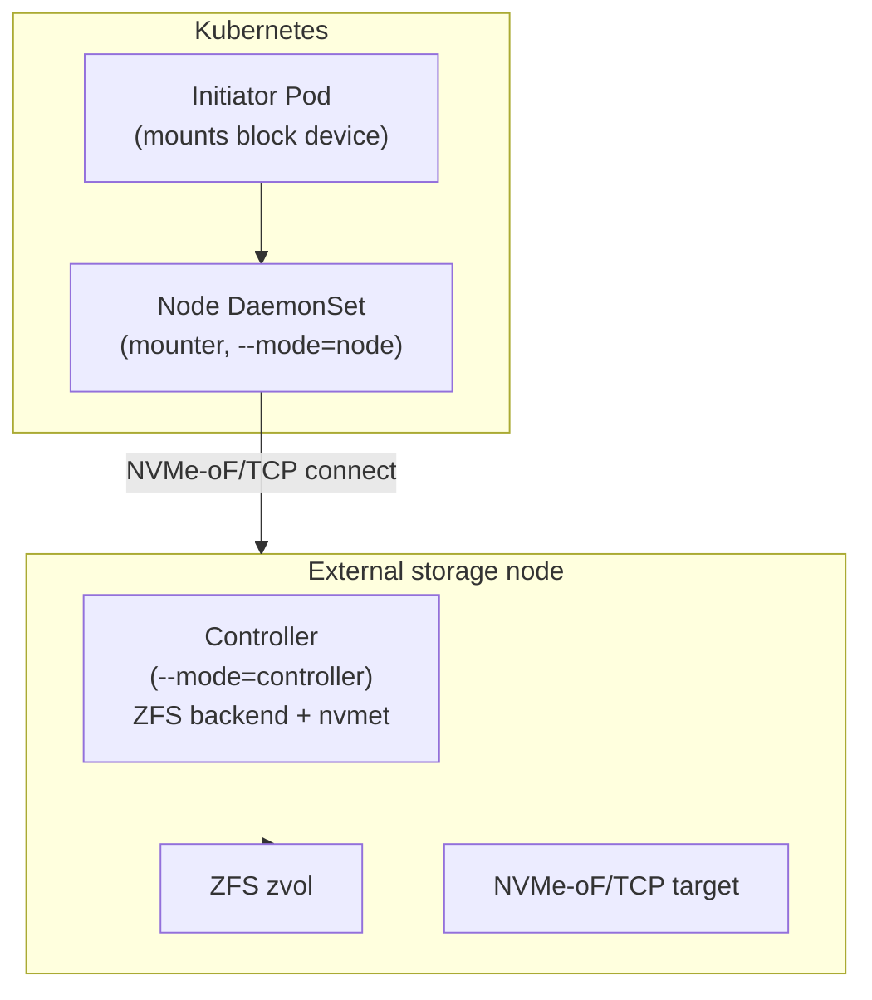

# Design: Helm chart for nvmeof-csi

## Purpose

`charts/nvmeof-csi` — Helm chart that renders the Kubernetes deployment
artifacts for the NVMe-oF/TCP CSI driver: the `CSIDriver` object, the controller
`Deployment` (storage backend side), and the node `DaemonSet` (initiator side).

## Components

- `Chart.yaml` — chart metadata (`name: nvmeof-csi`, `version: 0.1.0`).
- `values.yaml` — defaults: image (`repository`, `tag`, `pullPolicy`),
  `csi` (`pluginName`, `csiDriverName`, `pluginVersion`), `controller`
  (`enabled`, `replicaCount`, `mode`, `targetAddr`, `port`, `pool`), `node`
  (`enabled`, `mode`, `targetAddr`, `port`, `pool`).
- `templates/csi-driver.yaml` — renders the `CSIDriver` object
  (`nvmeof-csi` CR name, driver `com.timpa0130.nvmeof-csi`).
- `templates/controller.yaml` — renders the controller `Deployment` when
  `controller.enabled`.
- `templates/node-daemonset.yaml` — renders the node `DaemonSet` when
  `node.enabled`.

## Deployment topology

## Design notes

- Controller Deployment runs on the storage backend node; it provisions the
  ZFS zvol + NVMe-oF/TCP subsystem.
- Node DaemonSet runs per K8s worker; `--mode=node`; `--node-id=$(NODE_NAME)`
  resolved via `spec.nodeName` fieldRef; NVMe-oF/TCP target from
  `node.targetAddr`.
- Storage backend may live on a single external node while mounters run on
  K8s worker nodes.

## Open questions

- Pin `image.tag` to a released version.
- Controller `nodeSelector` / node tolerations configurability.
