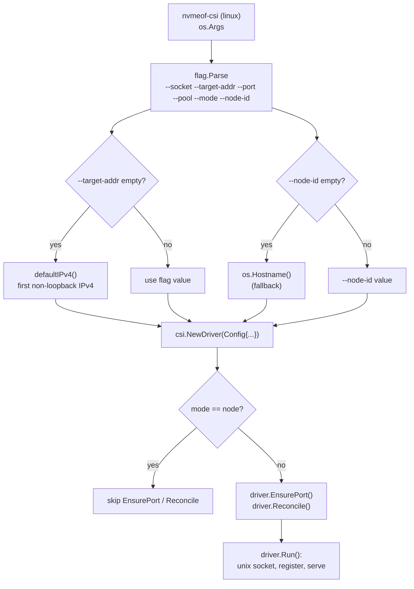

# Design: nvmeof-csi entrypoint and process lifecycle

## Purpose

Owns `cmd/nvmeof-csi/main.go`: flag parsing, driver construction, mode-based
behavior, and shutdown.

## Startup flow

## Flags

- `--socket` default `/run/csi/nvmeof-csi.sock`
- `--target-addr` default `""` → auto-detect via `defaultIPv4()` (first
  non-loopback IPv4)
- `--port` default `csi.DefaultPort` (`4420`)
- `--pool` default `nvme`
- `--mode` default `all`; validated to `all|controller|node`
- `--node-id` default `""` → falls back to `os.Hostname()` (K8s node name)

## Node-only behavior

Node-only processes have no target side → skip `EnsurePort()` and `Reconcile()`.

## Shutdown

Context from `signal.NotifyContext(SIGINT, SIGTERM)`; `driver.Run` graceful-stops
the gRPC server when the context is done.
