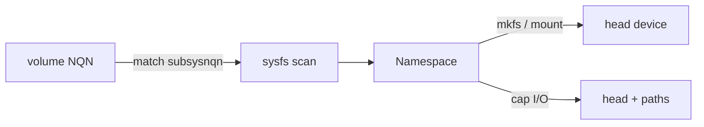

# Design: NVMe-oF/TCP initiator connection (pkg/node)

## Purpose

`pkg/node` — attaches/detaches the initiator to an NVMe-oF/TCP subsystem via
the `nvme` CLI, and owns the namespace's block devices (sysfs).

## Namespace module

A volume's namespace is one `Namespace` value — the single source of truth
for "which block devices belong to this NQN". Connect, disconnect, the I/O
cap and mkfs/mount all go through it.

| Item | Detail |
| ---- | ------ |
| Lookup | `LookupNamespace(nqn)` — every `/sys/block/*` whose `device/subsysnqn` equals the NQN |
| Head | `Namespace.Head` = `/dev/<entry without a "c" segment>` (e.g. `/dev/nvme1n1`); without multipath it is the only entry |
| Paths | `nvme<s>c<c>n1` — per-controller, carry the I/O; names are independent counters, so never constructed |
| Cap | `Namespace.CapIO()` — lowers `queue/max_sectors_kb` to 1024 on every entry; never raises |
| Why the cap | target advertises `mdts: 0`; its kernel rejects commands > 4 MiB with Data SGL Length Invalid (0x0f, DNR) — verified: 4 MiB ok, 4 MiB + 4 KiB fails |
| Why every device | path queues merge the head's bios back up to their own limit |

## Operations

- `Connect(ctx, nqn, traddr, trsvcid)` — `nvme connect -t tcp -n <nqn> -a <addr>
  [-s <trsvcid>]`; idempotent (namespace already present → no-op); waits for
  the namespace.
- `Disconnect(nqn)` — `nvme disconnect -n <nqn>`; idempotent (namespace gone
  → success).
- `LookupNamespace(nqn)` / `Namespace.CapIO()` — see above. Called from
  `NodeStageVolume` (both modes) and block-mode `NodePublishVolume`.
- `WaitForDevice(ctx, nqn)` — polls up to 10s for the namespace.

## Design notes

- Connection target derived from the subsystem NQN and configured
  target address/port.
