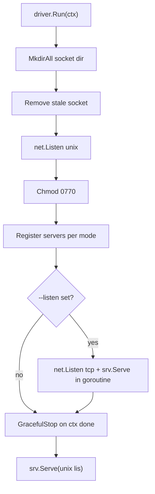

# Design: CSI gRPC server wiring

## Purpose

`Driver` wires the CSI servers to the backing subsystems. Stateless: everything
is derived from the volume ID.

## Components

- `Driver{cfg, target *nvmet.Target, zfs *zfs.ZFS}`
- `NewDriver(Config)` — validates mode (`all|controller|node`), defaults `""` → `all`.
- `EnsurePort()` — creates the shared NVMe-oF/TCP port via nvmet.
- `Reconcile()` — tears down configfs subsystems that carry our NQN root but
  whose backing zvol no longer exists.
- `Run(ctx)` — socket lifecycle, server registration, serve, graceful stop.
  Optionally also serves the same gRPC server over TCP (`Config.Listen`) so
  sidecars on other hosts (e.g. an external-provisioner dialing a controller
  that lives off-cluster) can reach it — unix sockets are filesystem-local
  and cannot be dialed over the network.

## Registration matrix

| mode         | Identity | Controller | Node |
| ------------ | -------- | ---------- | ---- |
| `all`        | yes      | yes        | yes  |
| `controller` | yes      | yes        | no   |
| `node`       | yes      | no         | yes  |

Identity is always registered; controller/node are mutually exclusive by mode.

Capability advertisement mirrors the matrix: a mode that serves the controller
advertises `CONTROLLER_SERVICE` via identity (`GetPluginCapabilities`), and a
mode that serves the node advertises node RPC capabilities (e.g.
`STAGE_UNSTAGE_VOLUME`) via the node service (`NodeGetCapabilities`).

## Run sequence

## Notes

- Socket dir is created if missing; stale socket file removed before listen.
- Socket is chmod `0770`.
- When TCP serving is enabled, both listeners share one gRPC server and one
  GracefulStop. The TCP endpoint carries the full API of the configured mode —
  for controller mode that includes `CreateVolume`/`DeleteVolume` (which exec
  `zfs` and drive nvmet configfs) — so restrict exposure (firewall/bind to a
  trusted interface); there is no transport auth.
