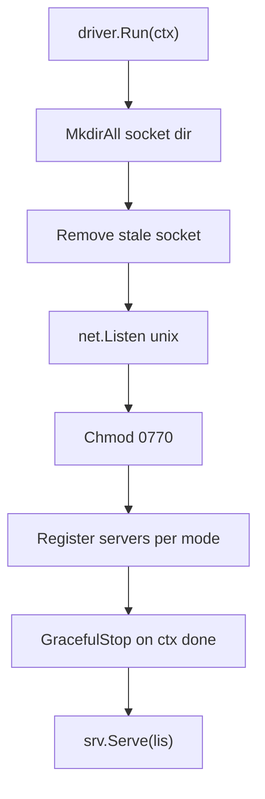

# Design: CSI gRPC server wiring

## Purpose

`Driver` wires the CSI servers to the backing subsystems. Stateless: everything
is derived from the volume ID.

## Components

- `Driver{cfg, target *nvmet.Target, zfs *zfs.ZFS}`
- `NewDriver(Config)` — validates mode (`all|controller|node`), defaults `""` → `all`.
- `EnsurePort()` — creates the shared NVMe-oF/TCP port via nvmet.
- `Reconcile()` — tears down configfs subsystems that carry our NQN root but
  whose backing zvol no longer exists.
- `Run(ctx)` — socket lifecycle, server registration, serve, graceful stop.

## Registration matrix

| mode         | Identity | Controller | Node |
| ------------ | -------- | ---------- | ---- |
| `all`        | yes      | yes        | yes  |
| `controller` | yes      | yes        | no   |
| `node`       | yes      | no         | yes  |

Identity is always registered; controller/node are mutually exclusive by mode.

## Run sequence

## Notes

- Socket dir is created if missing; stale socket file removed before listen.
- Socket is chmod `0770`.
- Server shut down via context cancellation (SIGINT/SIGTERM).
