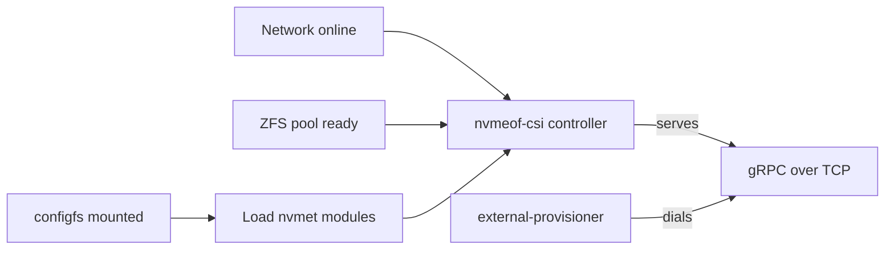

# Design: nvmeof-csi controller as a systemd service

## Purpose

Run `nvmeof-csi --mode=controller` directly on the NVMe-oF target host
(192.168.1.107) as a systemd service, outside Kubernetes. The controller owns
the ZFS zvols and the nvmet configfs tree on that host; the in-cluster
external-provisioner dials it over gRPC/TCP (`--listen`). This replaces the
chart's controller `Deployment` (`controller.enabled: false`).

## Startup ordering



| Box | Exact unit / setting |
| --- | --- |
| Network online | `Wants=` / `After=network-online.target` |
| ZFS pool ready | `Wants=zfs.target`; `After=zfs.target zfs-import.target zfs-volumes.target` |
| configfs mounted | `Requires=` / `After=sys-kernel-config.mount` |
| Load nvmet modules | `ExecStartPre=+/sbin/modprobe -a nvmet nvmet_tcp`; `After=systemd-modules-load.service` |
| nvmeof-csi controller | `nvmeof-csi-controller.service`, `ExecStart=/usr/local/bin/nvmeof-csi --mode=controller ...` |
| gRPC over TCP | `--listen=${NVMEOF_CSI_LISTEN}` (default `192.168.1.107:9090`) |
| external-provisioner | `--csi-address=tcp://192.168.1.107:9090` (in cluster) |

## Files

| Repo file | Installed as | Role |
| --- | --- | --- |
| `deploy/systemd/nvmeof-csi-controller.service` | `/etc/systemd/system/nvmeof-csi-controller.service` | unit |
| `deploy/systemd/nvmeof-csi-controller.env` | `/etc/default/nvmeof-csi-controller` | per-host flag values |
| `bin/nvmeof-csi` (linux build) | `/usr/local/bin/nvmeof-csi` | binary (same path as the image) |

## Args and environment

Same args as `charts/nvmeof-csi/templates/controller.yaml`; host-specific
values come from the env file, so the unit is identical on every target host.

| Flag | Value |
| --- | --- |
| `--mode` | `controller` (fixed in the unit) |
| `--socket` | `/run/csi/nvmeof-csi.sock` (fixed; local `csc` use) |
| `--listen` | `NVMEOF_CSI_LISTEN=192.168.1.107:9090` |
| `--target-addr` | `NVMEOF_CSI_TARGET_ADDR=192.168.1.107` |
| `--port` | `NVMEOF_CSI_PORT=4420` |
| `--pool` | `NVMEOF_CSI_POOL=nvme` |

## Privileges and lifecycle

The chart runs the controller `privileged: true` with `/sys/kernel/config`
and `/dev/zvol` mounted. On the host the unit keeps only what that covers:

| Setting | Why |
| --- | --- |
| `User=root` | nvmet configfs files under `/sys/kernel/config/nvmet` are root-owned |
| `CapabilityBoundingSet=CAP_SYS_ADMIN CAP_DAC_OVERRIDE` | `zfs`/`zpool` ioctls on `/dev/zfs` check `CAP_SYS_ADMIN` |
| `ExecStartPre=+...` | `modprobe` needs `CAP_SYS_MODULE`; `+` runs it outside the bounding set |
| `NoNewPrivileges=yes`, `ProtectSystem=full`, `ProtectHome=yes`, `PrivateTmp=yes` | hardening that leaves `/sys`, `/dev` writable |
| no `ProtectKernelTunables` / `PrivateDevices` | would make `/sys` read-only / hide `/dev/zfs`, `/dev/zvol` |
| `RuntimeDirectory=csi` | creates `/run/csi` for the socket; removed on stop |
| `Type=simple`, `Restart=on-failure`, `RestartSec=5s` | binary has no `sd_notify`; restart re-runs `EnsurePort` + `Reconcile` (idempotent) |
| `TimeoutStopSec=30s` | SIGTERM → `driver.Run` graceful-stops gRPC |

## Install / enable

```bash
CGO_ENABLED=0 GOOS=linux GOARCH=amd64 go build -o bin/nvmeof-csi ./cmd/nvmeof-csi
scp bin/nvmeof-csi deploy/systemd/nvmeof-csi-controller.* root@192.168.1.107:/tmp/
```

On the target host:

```bash
install -m 0755 /tmp/nvmeof-csi /usr/local/bin/nvmeof-csi
install -m 0644 /tmp/nvmeof-csi-controller.service /etc/systemd/system/
install -m 0644 /tmp/nvmeof-csi-controller.env /etc/default/nvmeof-csi-controller
systemctl daemon-reload
systemctl enable --now nvmeof-csi-controller
journalctl -u nvmeof-csi-controller -f
```

## Design notes

- Stopping the service does not tear down nvmet subsystems or ports: exports
  live in kernel configfs, so connected initiators keep I/O flowing while the
  controller restarts. Only provisioning (CreateVolume / DeleteVolume) pauses.
- The gRPC TCP endpoint has no TLS or auth (same as the chart's
  `controller.listen`); bind it to the storage network address only.
- `zfs-volumes.target` (zfsutils `zfs-volume-wait.service`) orders start after
  `/dev/zvol/*` links exist; if that unit is not enabled the `After=` is a
  no-op and `Reconcile` relies on the pool being imported.
- `CapabilityBoundingSet` is the tightest set the code paths need
  (`pkg/zfs` execs `zfs`/`zpool`, `pkg/nvmet` writes configfs); drop the line
  if a ZFS operation on the host fails with `EPERM`.
