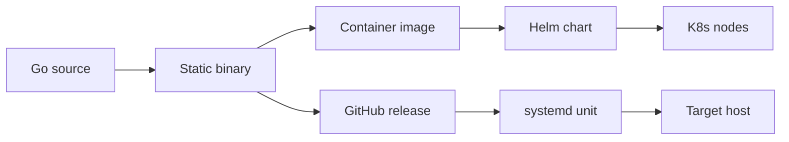
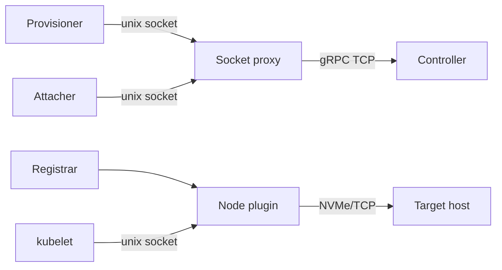
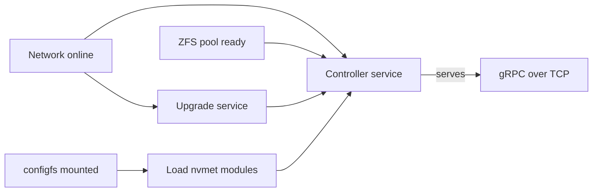

# Design: deployment

## Purpose

How the `nvmeof-csi` binary is built, packaged and run: the container image,
the Helm chart for the Kubernetes side, and the systemd service that runs the
controller directly on the NVMe-oF target host. What the processes do once
running is in `architecture.md` and `volume-lifecycle.md`.

## Overview



| Box | Exact name / setting |
| --- | --- |
| Static binary | `CGO_ENABLED=0 go build -o bin/nvmeof-csi ./cmd/nvmeof-csi` |
| Container image | `Dockerfile`: `alpine` + `nvme-cli` + `e2fsprogs` → `ghcr.io/timpa0130/nvmeof-csi` |
| Helm chart | `charts/nvmeof-csi`: `CSIDriver`, node `DaemonSet`, provisioner and attacher `Deployment`, `StorageClass` (no controller: it runs on the target host) |
| K8s nodes | node plugin `--mode=node` on every worker |
| GitHub release | asset `nvmeof-csi` (linux/amd64), `releases/latest/download/nvmeof-csi` |
| systemd unit | `deploy/systemd/nvmeof-csi-controller.service` + `.env`, `nvmeof-csi-upgrade.service` |
| Target host | controller `--mode=controller --listen=...` on 192.168.1.107 |

## Container image

| Item | Detail |
| --- | --- |
| Base | `alpine` — enough because the binary is statically linked |
| Packages | `nvme-cli` (connect/list/disconnect), `e2fsprogs` (`mkfs.ext4`, `blkid`) — only what the node execs |
| No ZFS tools | controller mode runs on the storage host, not from this image |
| Entrypoint | `/usr/local/bin/nvmeof-csi` |
| CI (`.github/workflows/build.yml`) | triggers on `Dockerfile`, `cmd/**`, `pkg/**`, `go.mod`, `go.sum`; PRs build only; `main` pushes `latest` + `sha-<short>`; releases upload `bin/nvmeof-csi` |

## Helm chart



| Template | Renders |
| --- | --- |
| `csi-driver.yaml` | `CSIDriver` named `csi.pluginName` (`com.timpa0130.nvmeof-csi`, must equal `GetPluginInfo`); `attachRequired: true`; `fsGroupPolicy: File` |
| `node-daemonset.yaml` | `--mode=node`, `--node-id=$(NODE_NAME)` (`spec.nodeName`), `--target-addr=node.targetAddr`; socket `/var/lib/kubelet/plugins/<pluginName>/csi.sock` (hostPath); `csi-node-driver-registrar` sidecar; `/var/lib/kubelet` with `Bidirectional` propagation; `/dev`; `/sys/block` (for the I/O cap) |
| `storageclass.yaml` | `StorageClass` `storageClass.name` with `provisioner: csi.pluginName` |
| `provisioner.yaml` | only when `provisioner.enabled` (default `true`); `ServiceAccount`, `ClusterRole`, `ClusterRoleBinding`, 1-replica `Deployment`, all `nvmeof-csi-provisioner`; `csi-provisioner:v6.4.0` with `--csi-address=/run/csi/csi.sock`, `--extra-create-metadata`; `csi-attacher:v4.8.1` with the same socket (`volumeattachments` patch and `volumeattachments/status` patch in the same role); `csi-proxy` sidecar `alpine/socat:1.8.0.3` bridging that socket (`emptyDir`) to `TCP:provisioner.controllerAddr` |

| Value | Default |
| --- | --- |
| `provisioner.enabled` | `true`; also gates the attacher, so disabling it stops volumes attaching |
| `provisioner.controllerAddr` | `192.168.1.10:9090` (must match the controller's `--listen`) |
| `image.repository` / `tag` / `pullPolicy` | `ghcr.io/timpa0130/nvmeof-csi` / `latest` / `Always` |
| `node.targetAddr` | `192.168.1.10` |
| `*.port`, `*.pool` | `4420`, `nvme` |
| `cluster` | `""`; the cluster ID passed to the node plugin, matching the controller's `NVMEOF_CSI_CLUSTER` |
| `csi.pluginName` | `com.timpa0130.nvmeof-csi`; must differ per cluster if two clusters' node plugins land on the same nodes |


## Controller as a systemd service

Runs `nvmeof-csi --mode=controller` on the target host outside Kubernetes.
This is the only supported way to run the controller; the chart has no
controller workload.



| Box | Exact unit / setting |
| --- | --- |
| Network online | `Wants=` / `After=network-online.target` |
| ZFS pool ready | `Wants=zfs.target`; `After=zfs.target zfs-import.target zfs-volumes.target` |
| Upgrade service | `nvmeof-csi-upgrade.service`, `Type=oneshot`: `curl ${NVMEOF_CSI_URL}` to `nvmeof-csi.new`, `chmod`, `mv` over the binary; the controller has `Wants=` / `After=` on it |
| configfs mounted | `Requires=` / `After=sys-kernel-config.mount` |
| Load nvmet modules | `ExecStartPre=+/sbin/modprobe -a nvmet nvmet_tcp`; `After=systemd-modules-load.service` |
| Controller service | `nvmeof-csi-controller.service`, `ExecStart=/usr/local/bin/nvmeof-csi --mode=controller ...` |
| gRPC over TCP | `--listen=${NVMEOF_CSI_LISTEN}`; the chart's `csi-proxy` sidecar dials `provisioner.controllerAddr` |

| Repo file | Installed as |
| --- | --- |
| `deploy/systemd/nvmeof-csi-controller.service` | `/etc/systemd/system/nvmeof-csi-controller.service` |
| `deploy/systemd/nvmeof-csi-upgrade.service` | `/etc/systemd/system/nvmeof-csi-upgrade.service` |
| `deploy/systemd/nvmeof-csi-controller.env` | `/etc/default/nvmeof-csi-controller` |
| release asset `nvmeof-csi` (downloaded by the upgrade service) | `/usr/local/bin/nvmeof-csi` |

| Flag | Source |
| --- | --- |
| `--mode`, `--socket` | fixed in the unit: `controller`, `/run/csi/nvmeof-csi.sock` |
| `--listen` | `NVMEOF_CSI_LISTEN=192.168.1.107:9090` |
| `--target-addr` | `NVMEOF_CSI_TARGET_ADDR=192.168.1.107` |
| `--port` | `NVMEOF_CSI_PORT=4420` |
| `--pool` | `NVMEOF_CSI_POOL=nvme` |
| `--cluster` | `NVMEOF_CSI_CLUSTER=` (empty = single-cluster names) |
| `--nvme-port` | `NVMEOF_CSI_NVME_PORT=1` |

| Setting | Why |
| --- | --- |
| `User=root` | nvmet configfs files are root-owned |
| `CapabilityBoundingSet=CAP_SYS_ADMIN CAP_DAC_OVERRIDE` | `zfs`/`zpool` ioctls on `/dev/zfs` need `CAP_SYS_ADMIN` |
| `ExecStartPre=+...` | `modprobe` needs `CAP_SYS_MODULE`; `+` runs it outside the bounding set |
| `Wants=nvmeof-csi-upgrade.service` | not `Requires=`: a failed download still starts the installed binary |
| `RemainAfterExit=yes` (upgrade service) | stays active after success, so it runs once per boot and not on controller crash restarts |
| `NVMEOF_CSI_URL` | chooses the binary: `releases/latest/download/nvmeof-csi` or `releases/download/<tag>/nvmeof-csi` |
| `NoNewPrivileges`, `ProtectSystem=full`, `ProtectHome`, `PrivateTmp` | hardening that leaves `/sys` and `/dev` writable |
| no `ProtectKernelTunables` / `PrivateDevices` | would make `/sys` read-only / hide `/dev/zfs`, `/dev/zvol` |
| `RuntimeDirectory=csi` | creates `/run/csi` for the socket; removed on stop |
| `Type=simple`, `Restart=on-failure`, `RestartSec=5s`, `TimeoutStopSec=30s` | no `sd_notify`; restart re-runs `EnsurePort` + `Reconcile` (idempotent) |

Install and enable:

```bash
scp deploy/systemd/nvmeof-csi-* root@192.168.1.107:/tmp/
```

On the target host (needs `curl`; the first start downloads the binary):

```bash
install -m 0644 /tmp/nvmeof-csi-controller.service /tmp/nvmeof-csi-upgrade.service /etc/systemd/system/
install -m 0644 /tmp/nvmeof-csi-controller.env /etc/default/nvmeof-csi-controller
systemctl daemon-reload
systemctl enable --now nvmeof-csi-controller
journalctl -u nvmeof-csi-controller -f
```

Upgrade now, or after changing `NVMEOF_CSI_URL`:

```bash
systemctl restart nvmeof-csi-upgrade nvmeof-csi-controller
```

To run a binary installed by hand, stop the downloads:

```bash
systemctl mask nvmeof-csi-upgrade
```

## Sharing one pool and target host between clusters

Several Kubernetes clusters can use one ZFS pool on one target host. Each gets
its own controller service, nvmet port and slice of the pool; nothing is shared
but the pool's space.

On the target host, copy `nvmeof-csi-controller.service` to
`nvmeof-csi-controller-<cluster>.service` and give the copy its own
environment file, socket and ports (`Wants=` on the same upgrade service is
fine, one binary serves all instances):

| Line | cluster 1 | cluster 2 |
| --- | --- | --- |
| `EnvironmentFile=` | `/etc/default/nvmeof-csi-controller` | `/etc/default/nvmeof-csi-controller-c2` |
| `RuntimeDirectory=` | `csi` | `csi-c2` |
| `--socket=` | `/run/csi/nvmeof-csi.sock` | `/run/csi-c2/nvmeof-csi.sock` |

and in the environment file:

| Variable | cluster 1 | cluster 2 | Why |
| --- | --- | --- | --- |
| `NVMEOF_CSI_CLUSTER` | *(empty)* | `c2` | scopes datasets, NQNs and grants |
| `NVMEOF_CSI_POOL` | `nvme` | `nvme` | the same pool |
| `NVMEOF_CSI_NVME_PORT` | `1` | `2` | configfs `ports/<n>`, numbered by the kernel |
| `NVMEOF_CSI_PORT` | `4420` | `4421` | `trsvcid`: the kernel refuses two ports on one `traddr` with the same `trsvcid` |
| `NVMEOF_CSI_LISTEN` | `192.168.1.107:9090` | `192.168.1.107:9091` | the gRPC endpoint the chart's socat sidecar dials |

Give the cluster its part of the pool. The dataset root is created by the first
`CreateVolume`; creating it up front is what lets you set the quota first:

```bash
zfs create -o mountpoint=none nvme/c2
zfs set quota=200G nvme/c2
```

`quota` (not `refquota`) because the cluster's zvols are descendants of that
root, and `GetCapacity` reads `available` from it, so the cluster is scheduled
against its own limit instead of the pool's free space.

In Kubernetes, one release per cluster. `csi.pluginName` differs here because
both clusters' node plugins write their socket under the same hostPath directory
name on shared nodes:

```bash
helm install nvmeof-csi-c2 charts/nvmeof-csi -n nvmeof-csi-c2 --create-namespace \
  --set cluster=c2 \
  --set csi.pluginName=com.timpa0130.nvmeof-csi-c2 \
  --set node.port=4421 \
  --set provisioner.controllerAddr=192.168.1.107:9091
```

Adding a cluster ID to a deployment that already has volumes is a rename of
every dataset and NQN, not a config change: do it before volumes exist, or
migrate them by hand.

## Design notes

- With the default `NVMEOF_CSI_URL` every reboot moves to the latest release,
  including a bad one. Pin a tag to upgrade only when you choose.
- The binary is not checked before it replaces the old one, beyond `curl -f`
  failing on an HTTP error or a cut-off download. It is trusted through HTTPS
  only; the release has no signature.
- Stopping the controller does not touch exports: they live in kernel
  configfs, so initiators keep I/O; only provisioning pauses.
- The gRPC TCP endpoint has no TLS or auth; bind it to the storage network.
- `csi-provisioner` and `csi-attacher` cannot dial TCP: `csi-lib-utils` rejects
  their connection-loss callback for non-`unix://` addresses. The socat sidecar
  gives them a local socket; if the TCP side drops, they exit on connection
  loss and their containers restart.
- Rebooting the target host empties in-memory configfs. On start the unit's
  `Reconcile` rebuilds every zvol's export and grant from the holder property on
  the zvol, without Kubernetes; initiators reconnect by themselves if the host is
  back within about 10 minutes. See `volume-lifecycle.md` § Recovery. Each
  cluster's controller does this only for its own dataset root and NQN root, so
  the instances do not disturb one another.
- The provisioner ships in the chart so deleting and reinstalling the
  release brings it back; before, a hand-applied provisioner was lost with
  the namespace and PVCs stayed `Pending`.
- Remove workloads and PVCs that use the driver before uninstalling the
  release. Otherwise pods using its volumes cannot unmount and hang in
  termination, and so does the namespace.
- `zfs-volumes.target` orders start after `/dev/zvol/*` exists; if
  `zfs-volume-wait.service` is not enabled the `After=` is a no-op.
- `CapabilityBoundingSet` is the tightest set the code needs; drop it if a
  ZFS operation on the host fails with `EPERM`.

## Open questions

- Multi-arch (amd64/arm64) image build.
- Pin `image.tag` to a released version.
- Controller `nodeSelector` / node tolerations in the chart.
