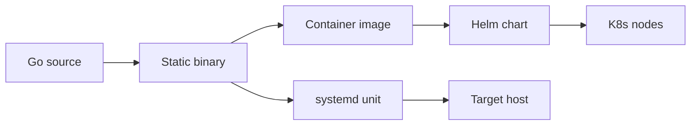
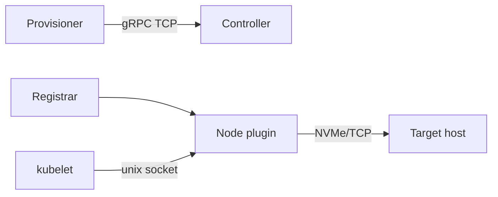
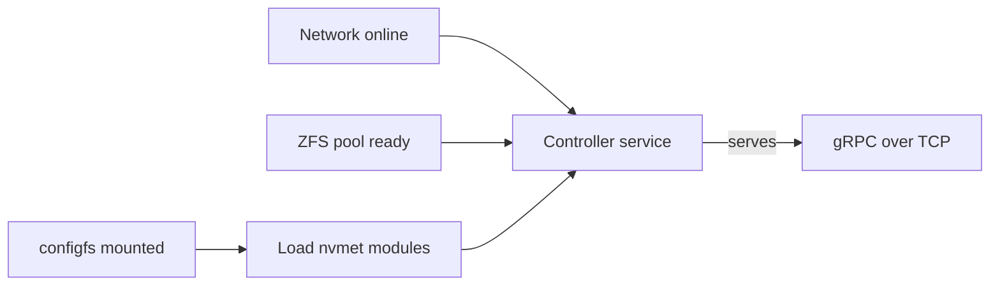

# Design: deployment

## Purpose

How the `nvmeof-csi` binary is built, packaged and run: the container image,
the Helm chart for the Kubernetes side, and the systemd service that runs the
controller directly on the NVMe-oF target host. What the processes do once
running is in `architecture.md` and `volume-lifecycle.md`.

## Overview



| Box | Exact name / setting |
| --- | --- |
| Static binary | `CGO_ENABLED=0 go build -o bin/nvmeof-csi ./cmd/nvmeof-csi` |
| Container image | `Dockerfile`: `alpine` + `nvme-cli` + `e2fsprogs` → `ghcr.io/timpa0130/nvmeof-csi` |
| Helm chart | `charts/nvmeof-csi`: `CSIDriver`, node `DaemonSet`, optional controller `Deployment`, `StorageClass` |
| K8s nodes | node plugin `--mode=node` on every worker |
| systemd unit | `deploy/systemd/nvmeof-csi-controller.service` + `.env` |
| Target host | controller `--mode=controller --listen=...` on 192.168.1.107 |

## Container image

| Item | Detail |
| --- | --- |
| Base | `alpine` — enough because the binary is statically linked |
| Packages | `nvme-cli` (connect/list/disconnect), `e2fsprogs` (`mkfs.ext4`, `blkid`) — only what the node execs |
| No ZFS tools | controller mode runs on the storage host, not from this image |
| Entrypoint | `/usr/local/bin/nvmeof-csi` |
| CI (`.github/workflows/build.yml`) | triggers on `Dockerfile`, `cmd/**`, `pkg/**`, `go.mod`, `go.sum`; PRs build only; `main` pushes `latest` + `sha-<short>`; releases upload `bin/nvmeof-csi` |

## Helm chart



| Template | Renders |
| --- | --- |
| `csi-driver.yaml` | `CSIDriver` named `csi.pluginName` (`com.timpa0130.nvmeof-csi`, must equal `GetPluginInfo`); `attachRequired: false`; `fsGroupPolicy: File` |
| `node-daemonset.yaml` | `--mode=node`, `--node-id=$(NODE_NAME)` (`spec.nodeName`), `--target-addr=node.targetAddr`; socket `/var/lib/kubelet/plugins/<pluginName>/csi.sock` (hostPath); `csi-node-driver-registrar` sidecar; `/var/lib/kubelet` with `Bidirectional` propagation; `/dev`; `/sys/block` (for the I/O cap) |
| `controller.yaml` | only when `controller.enabled` (default `false`); `privileged: true`; mounts `/sys/kernel/config`, `/dev/zvol`; args `--mode`, `--socket`, `--listen`, `--target-addr`, `--port`, `--pool` |
| `storageclass.yaml` | `StorageClass` `storageClass.name` with `provisioner: csi.pluginName` |

| Value | Default |
| --- | --- |
| `image.repository` / `tag` / `pullPolicy` | `ghcr.io/timpa0130/nvmeof-csi` / `latest` / `Always` |
| `controller.listen` | `""` (off); set to expose gRPC over TCP for remote sidecars |
| `controller.targetAddr`, `node.targetAddr` | `192.168.1.107` |
| `*.port`, `*.pool` | `4420`, `nvme` |

## Controller as a systemd service

Runs `nvmeof-csi --mode=controller` on the target host outside Kubernetes;
replaces the chart's controller `Deployment` (`controller.enabled: false`).



| Box | Exact unit / setting |
| --- | --- |
| Network online | `Wants=` / `After=network-online.target` |
| ZFS pool ready | `Wants=zfs.target`; `After=zfs.target zfs-import.target zfs-volumes.target` |
| configfs mounted | `Requires=` / `After=sys-kernel-config.mount` |
| Load nvmet modules | `ExecStartPre=+/sbin/modprobe -a nvmet nvmet_tcp`; `After=systemd-modules-load.service` |
| Controller service | `nvmeof-csi-controller.service`, `ExecStart=/usr/local/bin/nvmeof-csi --mode=controller ...` |
| gRPC over TCP | `--listen=${NVMEOF_CSI_LISTEN}`; provisioner dials `tcp://192.168.1.107:9090` |

| Repo file | Installed as |
| --- | --- |
| `deploy/systemd/nvmeof-csi-controller.service` | `/etc/systemd/system/nvmeof-csi-controller.service` |
| `deploy/systemd/nvmeof-csi-controller.env` | `/etc/default/nvmeof-csi-controller` |
| `bin/nvmeof-csi` (linux build) | `/usr/local/bin/nvmeof-csi` |

| Flag | Source |
| --- | --- |
| `--mode`, `--socket` | fixed in the unit: `controller`, `/run/csi/nvmeof-csi.sock` |
| `--listen` | `NVMEOF_CSI_LISTEN=192.168.1.107:9090` |
| `--target-addr` | `NVMEOF_CSI_TARGET_ADDR=192.168.1.107` |
| `--port` | `NVMEOF_CSI_PORT=4420` |
| `--pool` | `NVMEOF_CSI_POOL=nvme` |

| Setting | Why |
| --- | --- |
| `User=root` | nvmet configfs files are root-owned |
| `CapabilityBoundingSet=CAP_SYS_ADMIN CAP_DAC_OVERRIDE` | `zfs`/`zpool` ioctls on `/dev/zfs` need `CAP_SYS_ADMIN` |
| `ExecStartPre=+...` | `modprobe` needs `CAP_SYS_MODULE`; `+` runs it outside the bounding set |
| `NoNewPrivileges`, `ProtectSystem=full`, `ProtectHome`, `PrivateTmp` | hardening that leaves `/sys` and `/dev` writable |
| no `ProtectKernelTunables` / `PrivateDevices` | would make `/sys` read-only / hide `/dev/zfs`, `/dev/zvol` |
| `RuntimeDirectory=csi` | creates `/run/csi` for the socket; removed on stop |
| `Type=simple`, `Restart=on-failure`, `RestartSec=5s`, `TimeoutStopSec=30s` | no `sd_notify`; restart re-runs `EnsurePort` + `Reconcile` (idempotent) |

Install and enable:

```bash
CGO_ENABLED=0 GOOS=linux GOARCH=amd64 go build -o bin/nvmeof-csi ./cmd/nvmeof-csi
scp bin/nvmeof-csi deploy/systemd/nvmeof-csi-controller.* root@192.168.1.107:/tmp/
```

On the target host:

```bash
install -m 0755 /tmp/nvmeof-csi /usr/local/bin/nvmeof-csi
install -m 0644 /tmp/nvmeof-csi-controller.service /etc/systemd/system/
install -m 0644 /tmp/nvmeof-csi-controller.env /etc/default/nvmeof-csi-controller
systemctl daemon-reload
systemctl enable --now nvmeof-csi-controller
journalctl -u nvmeof-csi-controller -f
```

## Design notes

- Stopping the controller does not touch exports: they live in kernel
  configfs, so initiators keep I/O; only provisioning pauses.
- The gRPC TCP endpoint has no TLS or auth; bind it to the storage network.
- `zfs-volumes.target` orders start after `/dev/zvol/*` exists; if
  `zfs-volume-wait.service` is not enabled the `After=` is a no-op.
- `CapabilityBoundingSet` is the tightest set the code needs; drop it if a
  ZFS operation on the host fails with `EPERM`.

## Open questions

- Multi-arch (amd64/arm64) image build.
- Pin `image.tag` to a released version.
- Controller `nodeSelector` / node tolerations in the chart.
