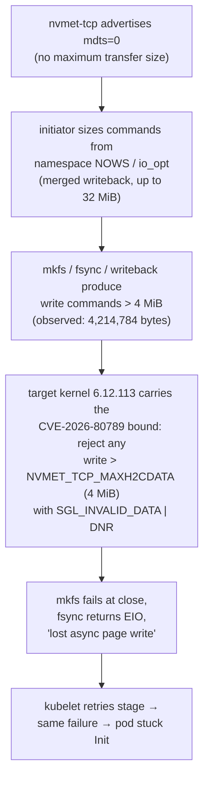
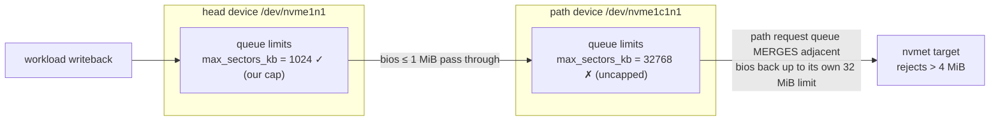
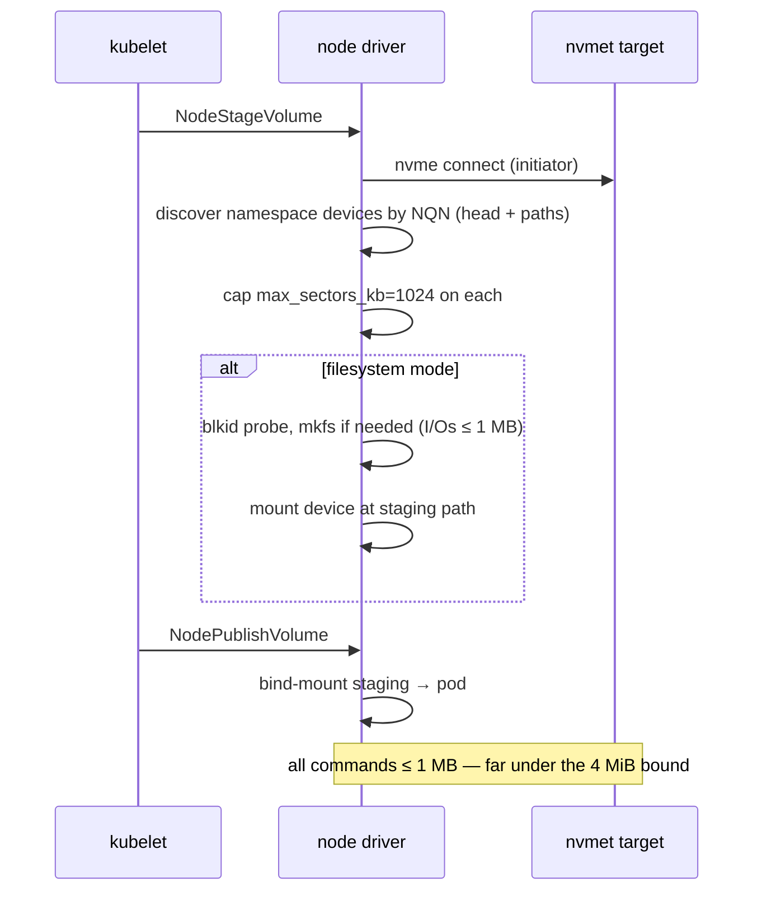

# Executive Summary: NVMe-oF Target Rejecting Large Writes

> **Status:** incident analysis (postmortem). Not a design doc — registered here so
> the mechanism is documented next to the components it touches.
>
> **Rebase plan:** deliberately deferred — a section placeholder sits at the bottom
> and will be filled when explicitly requested.

## TL;DR

Every volume operation that touched more than **4 MiB in a single NVMe write
command** was rejected by the target with **Data SGL Length Invalid**
(`NVME_SC_SGL_INVALID_DATA`, status `0x0f`, DNR). The initiator silently assembled commands that big because the
target advertises **no MDTS limit**, and our own 1 MiB workaround cap was
applied to the **multipath head device** while the actual I/O flows through the
**path device**, which has its own, uncapped queue limits. Capping **both**
devices at stage time fixed it: mkfs, fsync, and large buffered writes now work
on every volume size, and postgres + open-webui run on NVMe-oF volumes.

The failure threshold was brutally literal: our recorded failing write was
**4,214,784 bytes** — **20,480 bytes over** the target's 4 MiB
(`NVMET_TCP_MAXH2CDATA` = 4,194,304) rejection bound.

## Symptom timeline

| Stage | Symptom | What it looked like |
| ----- | ------- | ------------------- |
| postgres initdb | `could not fsync file …: Input/output error` | looked like a broken volume |
| openwebui stage | `mkfs.ext4: I/O error while writing out and closing file system` | looked like a broken mkfs |
| retries | same ops succeeded *sometimes* | looked like flaky hardware |
| 4G test volume | mkfs succeeded, 10G failed | looked like a size-dependent bug |
| our own 1 MiB cap | still failed | looked like the cap didn't work |

Each symptom was real; none of them was the root cause. They were all
downstream of one target-side rejection with a size threshold we hadn't found
yet.

## Root cause chain



### The decisive measurement

The target's own tracepoint captured the failing command and its completion:

```text
nvmet_req_init:    nvmet2: qid=1, cmdid=16411, nsid=1, cmd=(nvme_cmd_write,
                   slba=0, len=8231, ...)
nvmet_req_complete: nvmet2: qid=1, cmdid=16411, status=0x400f
```

* `len=8231` (0-based) → `8232 × 512 = 4,214,784` bytes
* target bound: `NVMET_TCP_MAXH2CDATA` = `4 MiB = 4,194,304` bytes
* overshoot: **20,480 bytes** — the command was rejected *deterministically*
  by the size bound, not because of corruption, space, or hardware

Initiator-side confirmation (kernel log):

```text
nvme1c1n1: I/O Cmd(0x1) @ LBA 0, 8232 blocks, I/O Error (sct 0x0 / sc 0xf) DNR
I/O error, dev nvme1c1n1, sector 0 op 0x1:(WRITE) flags 0x2000800 phys_seg 1029
```

**Boundary verification** (post-review, on the live cluster — O_DIRECT writes
through the path queue):

| Command size | Result |
| ----------- | ------ |
| exactly 4 MiB (4,194,304 B) | ✅ accepted |
| 4 MiB + 4 KiB (4,198,400 B) | ❌ rejected, EIO |

This proves the whole-command 4 MiB bound directly, rather than inferring it
from a single failing command.

### Why 4G volumes "worked" and 10G didn't

Not a hard volume-size threshold — a *merge-size* threshold, which correlates
with volume size (ext4's metadata layout spans more groups on a bigger fs, so
writeback merges grow). mkfs writeback merges
contiguous dirty pages into single commands. A 4 G filesystem (32 groups)
produces merged writebacks that happen to stay ≤ 4 MiB; a 10 G filesystem
(80 groups) crosses the bound. That is why every "size" experiment gave
contradictory-looking results and why the same operation flapped between OK
and EIO.

## Wrong turns worth recording

| Hypothesis | Verdict | What disproved it |
| ---------- | ------- | ----------------- |
| ZFS pool full / unhealthy | ✗ | `zpool list` 63.5 G free, 0 % frag; direct zvol writes OK |
| ZFS ARC memory pressure | ✗ (partially right instinct, wrong mechanism) | ARC already 23 MB when failures continued; no `page allocation failure` |
| Container vs host difference | ✗ | identical failures from pod and host shell |
| 4G-vs-10G volume bug | ✗ | merge-size artifact, not size |
| Our 1 MiB cap "not working" | ✓ but misapplied | cap landed on the wrong device (see below) |

One real side-bug found on the way: a **stale regular file** had replaced the
`/dev/nvme1n1` device node (created by tooling that ran while the device was
briefly absent — devtmpfs never overwrites an existing file). `mkfs -F`
"worked" into an 8 MB regular file and mounts failed with ENOTBLK. Rebuilt the
node from sysfs major:minor.

## Why the first fix didn't hold: multipath head vs path



With NVMe native multipath the namespace exposes **two** devices:

* **head** `nvme1n1` — what userspace opens, what our first cap touched
* **path** `nvme1c1n1` — the per-controller device whose queue limits actually
  shape the NVMe commands on the wire

We capped the head. The path request queue **merges** adjacent bios back into
requests up to its own (uncapped, 32 MiB) limit — splitting can only shrink
I/O, so the cap on the head never bounded what the path sent. Capping **the
path** made the very next 10 G mkfs succeed — proving the mechanism in one
step.

## The fix

`NodeStageVolume` now, for block and filesystem modes:

1. **looks up the namespace** (`LookupNamespace`) — every block device whose
   sysfs `device/subsysnqn` matches the volume's NQN. The head (`nvme<s>n1`)
   and all path devices (`nvme<s>c<c>n1`) are named after *independent*
   instance counters, so names are enumerated, never constructed. This one
   lookup is also what connect/disconnect/mount use;
2. **caps** `max_sectors_kb` to **1024** on each namespace device
   (`Namespace.CapIO`), *lowering only* — a device already at or below 1 MB
   is left untouched.

The stale regular-file device node is not handled by the driver — it was
created by manual tooling during debugging; a guard for it is a separate
decision.



Why 1024 KB: any cap ≤ 4 MiB avoids the target's rejection bound; 1 MB leaves
4× margin and is a common max-I/O choice for network block storage.

References: [CVE-2026-80789](https://www.cve.org/CVERecord?id=CVE-2026-80789)
(bound on `sgl->length` in `nvmet_tcp_map_data`, fixed in 6.12.106 — our
6.12.113 target includes it) and the proposed upstream follow-up
[`nvmet-tcp: report a bounded MDTS instead of "no limit"`](https://lists.infradead.org/pipermail/linux-nvme/2026-August/065541.html)
(v3, 2026-08, not yet merged).

The driver re-applies the cap on every stage attempt. Note the known gap: a
volume that is *already mounted* is never re-staged, so a device re-created
after staging (controller reconnect, newly appearing path) starts uncapped
until the next stage — see residual risks.

## Residual risks

1. **Devices (re-)created after staging start uncapped.** A plain reconnect
   that keeps the same path device keeps its cap; the cap is lost only when
   the controller is *re-created* (after `ctrl_loss_tmo`) or a new path
   appears — those create fresh block devices whose queue limits are
   re-derived from `mdts=0` + `NOWS`, and nothing re-stages a mounted
   volume, so nothing re-caps them until the next stage. A workload issuing
   > 4 MiB commands through such a device fails again. Mitigation options:
   periodically re-assert caps for known volumes in the driver, an
   event-driven `ACTION=="add"` **udev rule** on the host setting
   `max_sectors_kb`, or fixing the advertisement target-side (see risk 2).
   Note: on this initiator kernel (6.12), a user-set `max_sectors_kb`
   *survives* namespace revalidation (`nvme ns-rescan` verified) — it is
   device *re-creation*, not revalidation, that loses the cap.
2. **The target's `mdts=0` advertisement is the actual upstream bug.** The
   proper kernel fix (`nvmet-tcp: report a bounded MDTS`, linux-nvme list,
   [v3 2026-08](https://lists.infradead.org/pipermail/linux-nvme/2026-August/065541.html),
   not yet merged). The driver cap is now *lowering-only*: a
   device already at or below 1 MB is never touched, so a future target
   advertising a bound below 1 MB is not fought — removing the cap later
   simply means deleting the call.
3. **Alternative direction worth exploring:** the path queue inherited its
   32 MiB limit from the namespace's *optimal I/O size* (`NOWS`, derived
   from the zvol's `io_opt`). Making the target advertise a smaller optimal
   size (e.g. from the zvol's settings) might fix every initiator without
   any node-side cap.

## Verification (post-fix)

| Check | Result |
| ----- | ------ |
| 10 G mkfs (the original failure) | ✅ completes, all phases `done` |
| Path device limit after stage | `nvme1c1n1: 1024` |
| postgres on NVMe-oF volume | ✅ clean initdb, `pg_isready` accepting |
| open-webui on NVMe-oF volume | ✅ 1/1 Running, serving HTTP |

Caveat: this verification ran **before** the device-discovery rewrite — the
cluster was running the image built from `cd892a7` (main, tag `latest`),
which never caps anything: its `connect.go` expected a device path while
`node.go` passed the NQN, so the lookup became `/sys/block/<nqn>/queue/...`
and was silently skipped. **Every cap in the table above — head and path —
was a manual sysfs write**, not the driver. The
discovery-based code has unit tests but has **not** yet been re-verified
end-to-end in the cluster; our single node also happens to have matching
controller/subsystem instance numbers (`nvme1`/`nvme1c1n1`) — a node where
they differ is the stronger test case for the enumeration path.

## Rebase plan

*Placeholder — to be sketched on explicit request.* Corrections to the
original analysis affect (per the confirmed archaeology):

- **`cd892a7` (on `main`)** — **never caps anything**: its `connect.go`
  expects a device path (`CapMaxSectors(dev)`) while its `node.go` passes
  the NQN, so the lookup silently skipped. Its message's "chained SGLs"
  mechanism is also superseded. This is the main reword target.
- **tag `v1.2.0` → `19b15a0`** — that commit caps only the head (passes the
  device), so its message's mechanism claim is incomplete. `19b15a0` is **not
  an ancestor of `main` anymore** (the amend rewrote it); only the tag
  reaches it. Rewording `main` will not change what the release says —
  moving a published tag (and/or `gh release edit`) is a separate decision
  from the git rebase.
- The v1.2.0 release **notes** can be corrected with `gh release edit` —
  no git history involved.