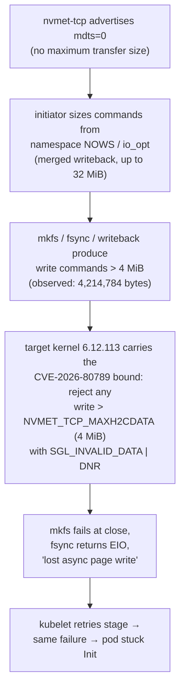
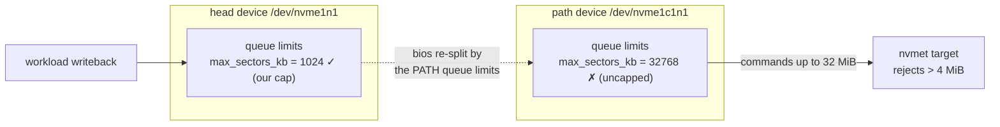
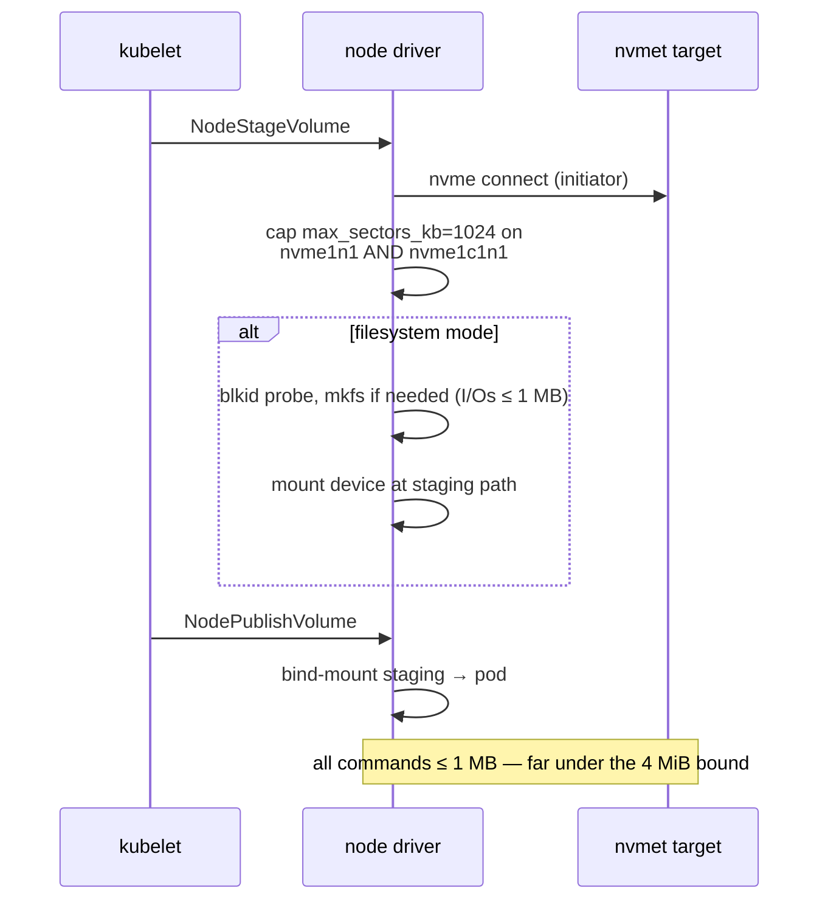

# Executive Summary: NVMe-oF Target Rejecting Large Writes

> **Status:** incident analysis (postmortem). Not a design doc — registered here so
> the mechanism is documented next to the components it touches.
>
> **Rebase plan:** deliberately deferred — a section placeholder sits at the bottom
> and will be filled when explicitly requested.

## TL;DR

Every volume operation that touched more than **4 MiB in a single NVMe write
command** was rejected by the target with `SGL Invalid Data Offset` (status
`0x0f`, DNR). The initiator silently assembled commands that big because the
target advertises **no MDTS limit**, and our own 1 MiB workaround cap was
applied to the **multipath head device** while the actual I/O flows through the
**path device**, which has its own, uncapped queue limits. Capping **both**
devices at stage time fixed it: mkfs, fsync, and large buffered writes now work
on every volume size, and postgres + open-webui run on NVMe-oF volumes.

The failure threshold was brutally literal: our recorded failing write was
**4,214,784 bytes** — **20,480 bytes over** the target's 4 MiB
(`NVMET_TCP_MAXH2CDATA` = 4,194,304) rejection bound.

## Symptom timeline

| Stage | Symptom | What it looked like |
| ----- | ------- | ------------------- |
| postgres initdb | `could not fsync file …: Input/output error` | looked like a broken volume |
| openwebui stage | `mkfs.ext4: I/O error while writing out and closing file system` | looked like a broken mkfs |
| retries | same ops succeeded *sometimes* | looked like flaky hardware |
| 4G test volume | mkfs succeeded, 10G failed | looked like a size-dependent bug |
| our own 1 MiB cap | still failed | looked like the cap didn't work |

Each symptom was real; none of them was the root cause. They were all
downstream of one target-side rejection with a size threshold we hadn't found
yet.

## Root cause chain



### The decisive measurement

The target's own tracepoint captured the failing command and its completion:

```text
nvmet_req_init:    nvmet2: qid=1, cmdid=16411, nsid=1, cmd=(nvme_cmd_write,
                   slba=0, len=8231, ...)
nvmet_req_complete: nvmet2: qid=1, cmdid=16411, status=0x400f
```

* `len=8231` (0-based) → `8232 × 512 = 4,214,784` bytes
* target bound: `NVMET_TCP_MAXH2CDATA` = `4 MiB = 4,194,304` bytes
* overshoot: **20,480 bytes** — the command was rejected *deterministically*
  by the size bound, not because of corruption, space, or hardware

Initiator-side confirmation (kernel log):

```text
nvme1c1n1: I/O Cmd(0x1) @ LBA 0, 8232 blocks, I/O Error (sct 0x0 / sc 0xf) DNR
I/O error, dev nvme1c1n1, sector 0 op 0x1:(WRITE) flags 0x2000800 phys_seg 1029
```

### Why 4G volumes "worked" and 10G didn't

Not size-dependent at all — *merge-size* dependent. mkfs writeback merges
contiguous dirty pages into single commands. A 4 G filesystem (32 groups)
produces merged writebacks that happen to stay ≤ 4 MiB; a 10 G filesystem
(80 groups) crosses the bound. That is why every "size" experiment gave
contradictory-looking results and why the same operation flapped between OK
and EIO.

## Wrong turns worth recording

| Hypothesis | Verdict | What disproved it |
| ---------- | ------- | ----------------- |
| ZFS pool full / unhealthy | ✗ | `zpool list` 63.5 G free, 0 % frag; direct zvol writes OK |
| ZFS ARC memory pressure | ✗ (partially right instinct, wrong mechanism) | ARC already 23 MB when failures continued; no `page allocation failure` |
| Container vs host difference | ✗ | identical failures from pod and host shell |
| 4G-vs-10G volume bug | ✗ | merge-size artifact, not size |
| Our 1 MiB cap "not working" | ✓ but misapplied | cap landed on the wrong device (see below) |

One real side-bug found on the way: a **stale regular file** had replaced the
`/dev/nvme1n1` device node (created by tooling that ran while the device was
briefly absent — devtmpfs never overwrites an existing file). `mkfs -F`
"worked" into an 8 MB regular file and mounts failed with ENOTBLK. Rebuilt the
node from sysfs major:minor.

## Why the first fix didn't hold: multipath head vs path



With NVMe native multipath the namespace exposes **two** devices:

* **head** `nvme1n1` — what userspace opens, what our first cap touched
* **path** `nvme1c1n1` — the per-controller device whose queue limits actually
  shape the NVMe commands on the wire

We capped the head. The path re-split the bios by its own (uncapped, 32 MiB)
limit, so > 4 MiB commands still reached the target. Capping **the path** made
the very next 10 G mkfs succeed — proving the mechanism in one step.

## The fix

`NodeStageVolume` now caps `max_sectors_kb` to **1024** (1 MB — one SGL
segment, 256 × 4K descriptors) on **both** the head and the path device, for
block and filesystem modes:



Why 1024 KB: it is the largest single-SGL-segment I/O (256 × 4K descriptors),
comfortably under the target's 4 MiB rejection bound, and the de-facto max I/O
for network block storage — negligible throughput cost.

The driver re-applies the cap on every stage attempt, which also heals the
residual flakiness source: queue-limit revalidations (triggered by volume
create/destroy AENs) can reset the limits between stages; the next stage
attempt re-caps before any workload I/O.

## Residual risks

1. **Queue-limit revalidations reset the cap mid-flight.** A workload writing
   > 4 MiB commands *while* a revalidate lands can still fail once. Steady
   state is unaffected (caps hold; re-capped on next stage).
2. **The target's `mdts=0` advertisement is the actual upstream bug.** The
   proper kernel fix (`nvmet-tcp: report a bounded MDTS`, linux-nvme list) is
   not yet merged. Once a target kernel carries it, the driver cap becomes
   redundant — the sysfs write only lowers a *higher* value, so removing the
   cap later is safe.

## Verification (post-fix)

| Check | Result |
| ----- | ------ |
| 10 G mkfs (the original failure) | ✅ completes, all phases `done` |
| Path device limit after stage | `nvme1c1n1: 1024` |
| postgres on NVMe-oF volume | ✅ clean initdb, `pg_isready` accepting |
| open-webui on NVMe-oF volume | ✅ 1/1 Running, serving HTTP |

## Rebase plan

*Placeholder — to be sketched on explicit request.* The candidate targets are
commit `19b15a0` ("fix: cap device max I/O at 1MB…") and the v1.2.0 release
notes: both describe the mechanism as "chained SGLs" and "multi-MB chained
SGLs", which the final analysis superseded with the precise 4 MiB
`NVMET_TCP_MAXH2CDATA` bound and the multipath head/path split. Working on
`main` makes a force-push rewrite acceptable here — the workflow-equivalent of
having done it on a branch — but the exact rebase/reword sequence belongs in
this section once requested.