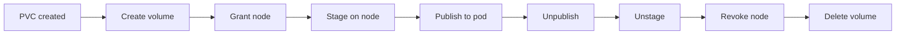
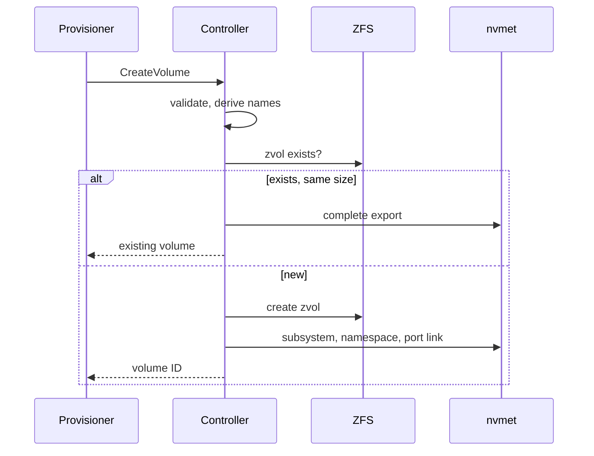
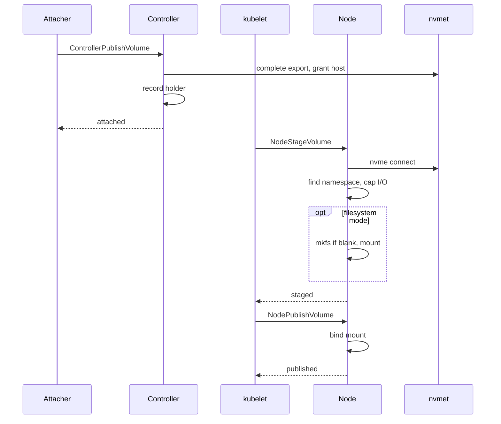
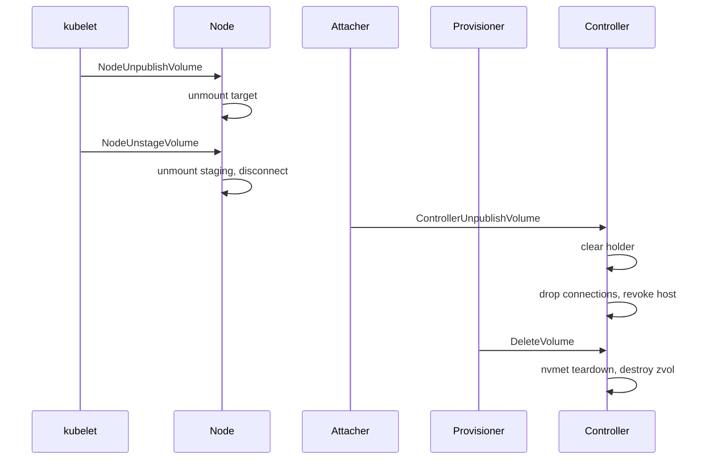
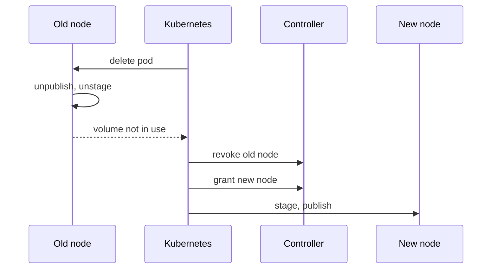
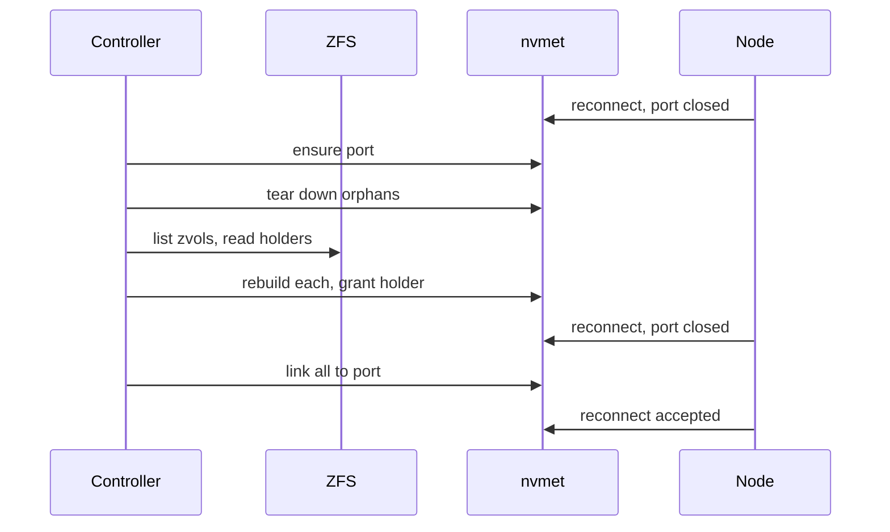

# Design: volume lifecycle

## Purpose

How the code flows when a volume is created, attached to a pod, and removed:
which RPC runs where, what it touches on the target host and on the node, and
what makes each step safe to retry. Components and naming are in
`architecture.md`.

## Overview

| Box | RPC | Runs on | Touches |
| --- | --- | --- | --- |
| Create volume | `CreateVolume` | controller | `zfs create`, nvmet subsystem / namespace / port link |
| Grant node | `ControllerPublishVolume` | controller | nvmet `allowed_hosts` link for the node's host NQN, holder property on the zvol |
| Stage on node | `NodeStageVolume` | node | `nvme connect`, sysfs I/O cap, `mkfs` + mount (filesystem mode) |
| Publish to pod | `NodePublishVolume` | node | bind mount into the pod's target path |
| Unpublish | `NodeUnpublishVolume` | node | unmount target |
| Unstage | `NodeUnstageVolume` | node | unmount staging (filesystem mode), `nvme disconnect` |
| Revoke node | `ControllerUnpublishVolume` | controller | drop connections, remove the `allowed_hosts` link |
| Delete volume | `DeleteVolume` | controller | nvmet teardown, `zfs destroy` |

## 1. Create

The external-provisioner calls `CreateVolume` with the PVC's namespace/name in
the parameters. The controller derives every name and builds the export
bottom-up: zvol, then subsystem, then namespace, then port link.

| Step | Detail |
| --- | --- |
| validate | `validateCapabilities`; namespace/name from `csi.storage.k8s.io/pvc/namespace` / `pvc/name`, else `req.GetName()`; `ValidNamespace`/`ValidName`; `MaxNQN`, `MaxDataset` → `InvalidArgument` |
| derive names | volume ID, NQN, dataset from `pkg/ids` `Scope{Pool, Cluster}` — the cluster ID adds a dataset component and an NQN label, so a sibling cluster sharing the pool cannot name the same object |
| zvol exists? | same `volsize` → return it (idempotent); different size → `AlreadyExists` |
| complete export | `exportVolume`, for a retry after an earlier attempt stopped short; failure → `Internal`, the zvol is kept |
| create zvol | parents with `mountpoint=none`, then `zfs create -V <bytes> -o volblocksize=16K <dataset>`; waits for `/dev/zvol/<dataset>` (udev) |
| subsystem, namespace, port link | `exportVolume` → `ExportVolume(nqn, /dev/zvol/...)`: `CreateSubsystem(nqn)` with `attr_allow_any_host=0`, so no host can connect yet; `CreateNamespace(nqn, 1, ...)`, which leaves an enabled namespace alone; `LinkSubsystemToPort(nqn)` on this driver's `--nvme-port` |
| on any failure | `TeardownVolume(nqn)` + `DestroyVolume(dataset)`, then `Internal` — no half-built volume is left |

## 2. Grant, stage and publish

A pod scheduled to a node creates a `VolumeAttachment`, and kubelet waits for it
before staging. The grant is what lets the node connect. kubelet stages once
per node, then publishes per pod. The node never constructs device names: it
connects by NQN and finds the namespace's block devices in sysfs.

| Step | Detail |
| --- | --- |
| complete export | `exportVolume`, retrying a volume `Reconcile` could not export; failure → `Internal` |
| grant host | `GrantHost(nqn, HostNQN(nodeID))`: `attr_allow_any_host=0`, `hosts/<host>`, `allowed_hosts/<host>` link; same node → success; other node → `FailedPrecondition`; no zvol → `NotFound` |
| record holder | `zfs set com.timpa0130.nvmeof-csi:holder=<node ID>` on the zvol; failure → `Internal`, and the retry completes it, so `attached` always has a record |
| nvme connect | `nvme connect -t tcp -n <nqn> -a <target-addr> -s <port> --hostnqn <host> --hostid <id>`; no-op when the namespace already exists; waits up to 10s for it; fails if the node has no grant |
| find namespace | `LookupNamespace(nqn)`: every `/sys/block/*` whose `device/subsysnqn` equals the NQN. Head = the entry without a `c` segment (`/dev/nvme1n1`); paths = `nvme<s>c<c>n1` |
| cap I/O | `Namespace.CapIO()` lowers `queue/max_sectors_kb` to `1024` on head **and** paths; runs on every stage (and block publish) before any early return |
| mkfs if blank, mount | `blkid` probe on the head; `mkfs.<fsType>` (default `ext4`) only when no filesystem; mount head → staging path |
| bind mount (block) | target must be a file (created if absent); bind `/dev/nvmeXnY` → target |
| bind mount (filesystem) | target dir created if absent; bind staging → target |
| already mounted | skipped — stage and publish are retry-safe |

Why the I/O cap: the target advertises `mdts: 0` and its kernel rejects
commands > 4 MiB (Data SGL Length Invalid, DNR). Path queues re-merge the
head's bios up to their own limit, so every device of the namespace is capped.
Full analysis: `incident-nvmet-tcp-4mib-write-rejection.md`.

## 3. Teardown

Reverse order of the above. Every step treats "already gone" as success, so
kubelet and the sidecars can retry freely.

| Step | Detail |
| --- | --- |
| unmount target | tolerates `EINVAL` / `ENOENT` (not mounted) |
| unmount staging, disconnect | unmount only when mounted (filesystem mode); `nvme disconnect -n <nqn>`; namespace gone → success |
| clear holder | only if this node is the recorded holder (or no node was named); before the revoke, because no other node can be granted until then, so a retry cannot clear a newer holder's record |
| drop connections, revoke host | `RevokeHost(nqn, host)`: only if `host` holds it, unlink the port (deletes its controllers) and remove the `allowed_hosts` link; then always restore the port link. Other subsystems are untouched. No subsystem → success |
| nvmet teardown | `TeardownVolume(nqn)`: unlink port, remove `allowed_hosts` links, remove namespace, remove subsystem |
| destroy zvol | `zfs destroy <dataset>`; parent datasets left in place; missing volume → success |

## Moving between nodes

Only one node can hold a volume. The new node's attach is refused until the old
one is detached, so its pod waits in `ContainerCreating` with a multi-attach
event instead of mounting the volume twice.

| Case | When the old node is revoked |
| --- | --- |
| Drain, either workload type | once the old node reports the volume no longer in use |
| Dead node | after the pod is gone (force delete, or out-of-service taint) and Kubernetes force-detaches; default wait 6 minutes |
| Running but partitioned node | as for a dead node; the revoke drops its connection, so its I/O stops reaching the target |

The revoke is the fence: a node cut off from the API server cannot be asked to
unmount, but the target stops serving it regardless. Its next reconnect is
refused with do-not-retry: kernels with upstream commit `adfde7ed0b30` then remove
the controller, so the node stays out until it stages the volume again, and older
kernels keep retrying until `ctrl_loss_tmo`. Unflushed writes on a dead or fenced
node are lost; the new node replays the ext4 journal.

## Recovery: reconcile on startup

The pool is durable and configfs is not, so on every controller start
`Reconcile()` makes configfs match the pool, including who holds each volume, so
a node's first reconnect after a reboot is accepted and its pods keep running.

| Step | Detail |
| --- | --- |
| reconnect, port closed | a port with no subsystem linked does not listen, so TCP connect fails; the initiator retries every `reconnect_delay` (10s) until `ctrl_loss_tmo` (10 minutes) |
| ensure port | `EnsurePort`, in `main` before `Reconcile` |
| tear down orphans | subsystems with this cluster's NQN root whose dataset no longer exists; `TeardownVolume(nqn)`; failure stops startup. A sibling cluster's subsystems fail `ParseNQN` and are left alone |
| list zvols, read holders | `zfs.Volumes()`; failure stops startup. `ParseDataset` skips any zvol outside this cluster's dataset root `<pool>[/<cluster>]`; `zfs get` of the holder property |
| rebuild each, grant holder | `restoreVolume`: waits up to 5s for `/dev/zvol/<dataset>`, `PrepareVolume` with `NamespaceUUID(volumeID)`, `GrantHost` when a holder is recorded; failure is logged and the next zvol continues |
| link all to port | `LinkSubsystemToPort` for every restored volume, as the last step |

Live exports are untouched, so initiators keep their I/O across a controller
restart: `CreateNamespace` skips an enabled namespace, and links and grants are
kept.

### Design notes

- Goal: volumes are unavailable while the target host is down, and recover by
  themselves once it is back. Workers on the same host restart with it and stage
  from scratch. Workers beside a separate NAS keep running and reconnect, which is
  what the three choices below are for.
- Why the holder is stored: a host refused by nvmet gets do-not-retry and removes
  its controller, and kubelet does not re-stage a running pod. So grants must be
  back before a host can reach a subsystem, which rules out waiting for the attacher.
  The cost is a second record of the attachment beside `VolumeAttachment`s.
- Why links come last and together: the first link opens the shared port, and a
  host connecting to a subsystem not linked yet is refused the same way. Linking
  after the slow steps leaves only the time between links.
- Why the namespace UUID is derived: nvmet randomises it on every rebuild, and an
  initiator removes a namespace whose identifiers changed when it reconnects. A
  namespace enabled before this keeps its random UUID until its next rebuild, so its
  pods need one restart after the first reboot.
- A bad zvol must not exit the process: that would keep every other volume down.
  `ControllerPublishVolume` retries its export.
- Every zvol under the cluster's dataset root is exported, since that part of
  the pool is dedicated to the driver. With `--cluster` set the root is
  `<pool>/<cluster>`, so the pool can hold several clusters' zvols without any
  of them being exported, listed or torn down by the wrong controller.
- Known gap: a volume `Reconcile` could not restore refuses its node once the port
  opens, so that node loses its controller and its pods must restart.
- Known gap: if the target stays away longer than `ctrl_loss_tmo`, the node drops
  the controller and filesystems on it fail; the driver does not recover that.
- Known gap: a grant or record with no `VolumeAttachment` left is never revoked, and
  keeps other nodes out of that volume.

## Other controller RPCs

| RPC | Behavior |
| --- | --- |
| `ValidateVolumeCapabilities` | zvol must exist (`NotFound` otherwise), then capability check |
| `ListVolumes` | `zfs list -t volume`, with `volsize` per dataset; zvols outside this cluster's dataset root are skipped |
| `GetCapacity` | `zfs get available <dataset root>`: the pool, or the cluster's dataset under it, so a `quota` set there is the capacity the cluster is given (see `deployment.md`) |

## Manual end-to-end check

`test/manual/e2e.sh` walks this whole lifecycle without Kubernetes, as root,
using `csc` against the driver socket: probe → create → stage refused → grant →
second node refused → stage → publish → `dd` write/verify on the device → revoke
drops the connection → re-grant, re-stage, verify data → empty configfs with the
driver stopped and restart it, twice: once staging from scratch (same-node setup),
once with the node still connected (separate NAS), verifying data each time →
unpublish → unstage → revoke → delete → orphan check. The reboot steps need the
script's own driver and a port with no other volumes, and are skipped otherwise.
