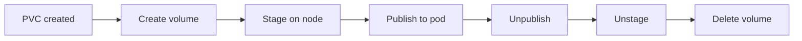
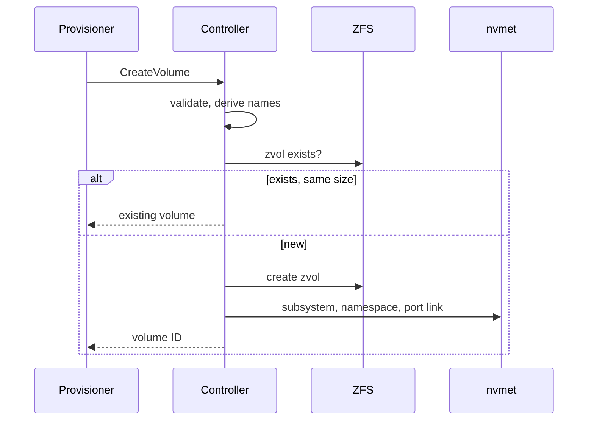
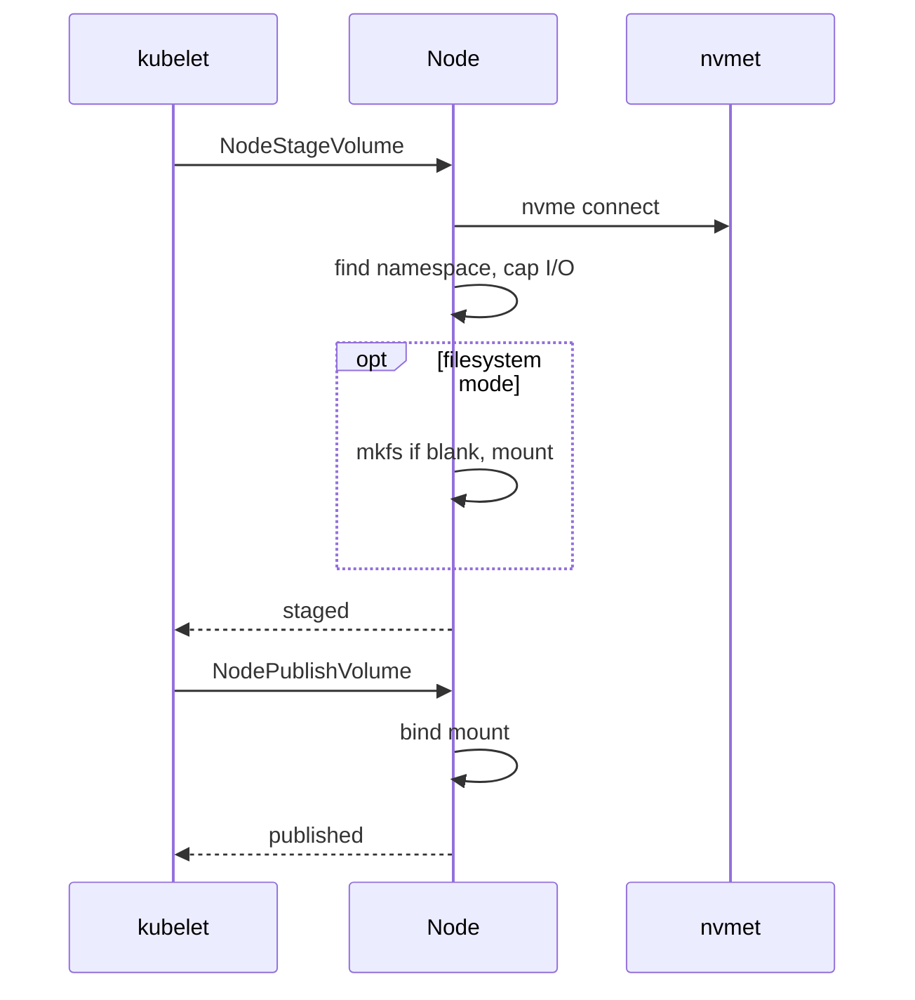
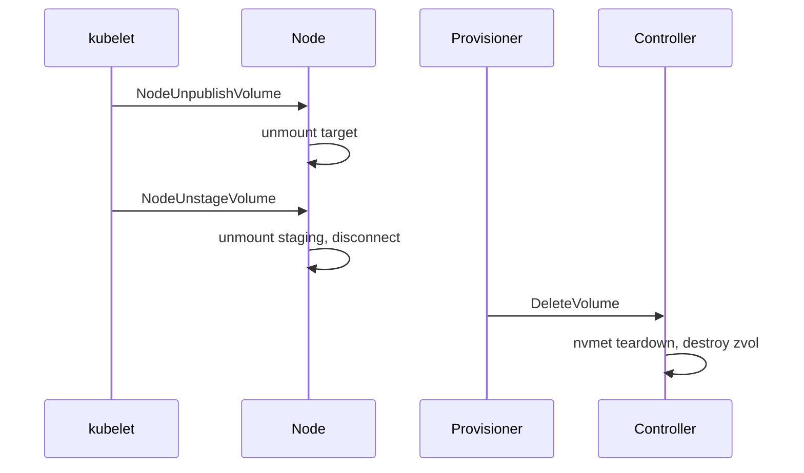

# Design: volume lifecycle

## Purpose

How the code flows when a volume is created, attached to a pod, and removed:
which RPC runs where, what it touches on the target host and on the node, and
what makes each step safe to retry. Components and naming are in
`architecture.md`.

## Overview

| Box | RPC | Runs on | Touches |
| --- | --- | --- | --- |
| Create volume | `CreateVolume` | controller | `zfs create`, nvmet subsystem / namespace / port link |
| Stage on node | `NodeStageVolume` | node | `nvme connect`, sysfs I/O cap, `mkfs` + mount (filesystem mode) |
| Publish to pod | `NodePublishVolume` | node | bind mount into the pod's target path |
| Unpublish | `NodeUnpublishVolume` | node | unmount target |
| Unstage | `NodeUnstageVolume` | node | unmount staging (filesystem mode), `nvme disconnect` |
| Delete volume | `DeleteVolume` | controller | nvmet teardown, `zfs destroy` |

## 1. Create

The external-provisioner calls `CreateVolume` with the PVC's namespace/name in
the parameters. The controller derives every name and builds the export
bottom-up: zvol, then subsystem, then namespace, then port link.

| Step | Detail |
| --- | --- |
| validate | `validateCapabilities`; namespace/name from `csi.storage.k8s.io/pvc/namespace` / `pvc/name`, else `req.GetName()`; `ValidNamespace`/`ValidName`; `MaxNQN`, `MaxDataset` → `InvalidArgument` |
| derive names | volume ID, NQN, dataset (`pkg/ids`) |
| zvol exists? | same `volsize` → return it (idempotent); different size → `AlreadyExists` |
| create zvol | parents with `mountpoint=none`, then `zfs create -V <bytes> -o volblocksize=16K <dataset>`; waits for `/dev/zvol/<dataset>` (udev) |
| subsystem, namespace, port link | `CreateSubsystem(nqn)`, `CreateNamespace(nqn, 1, /dev/zvol/...)`, `LinkSubsystemToPort(nqn)` on port `1` |
| on any failure | `TeardownVolume(nqn)` + `DestroyVolume(dataset)`, then `Internal` — no half-built volume is left |

## 2. Stage and publish

kubelet stages once per node, then publishes per pod. The node never
constructs device names: it connects by NQN and finds the namespace's block
devices in sysfs.

| Step | Detail |
| --- | --- |
| nvme connect | `nvme connect -t tcp -n <nqn> -a <target-addr> -s <port>`; no-op when the namespace already exists; waits up to 10s for it |
| find namespace | `LookupNamespace(nqn)`: every `/sys/block/*` whose `device/subsysnqn` equals the NQN. Head = the entry without a `c` segment (`/dev/nvme1n1`); paths = `nvme<s>c<c>n1` |
| cap I/O | `Namespace.CapIO()` lowers `queue/max_sectors_kb` to `1024` on head **and** paths; runs on every stage (and block publish) before any early return |
| mkfs if blank, mount | `blkid` probe on the head; `mkfs.<fsType>` (default `ext4`) only when no filesystem; mount head → staging path |
| bind mount (block) | target must be a file (created if absent); bind `/dev/nvmeXnY` → target |
| bind mount (filesystem) | target dir created if absent; bind staging → target |
| already mounted | skipped — stage and publish are retry-safe |

Why the I/O cap: the target advertises `mdts: 0` and its kernel rejects
commands > 4 MiB (Data SGL Length Invalid, DNR). Path queues re-merge the
head's bios up to their own limit, so every device of the namespace is capped.
Full analysis: `incident-nvmet-tcp-4mib-write-rejection.md`.

## 3. Teardown

Reverse order of the above. Every step treats "already gone" as success, so
kubelet and the provisioner can retry freely.

| Step | Detail |
| --- | --- |
| unmount target | tolerates `EINVAL` / `ENOENT` (not mounted) |
| unmount staging, disconnect | unmount only when mounted (filesystem mode); `nvme disconnect -n <nqn>`; namespace gone → success |
| nvmet teardown | `TeardownVolume(nqn)`: unlink port, remove namespace, remove subsystem |
| destroy zvol | `zfs destroy <dataset>`; parent datasets left in place; missing volume → success |

## Recovery: reconcile on startup

A controller crash between steps can leave a subsystem without its zvol.
On every controller start, `Reconcile()` lists nvmet subsystems with our NQN
root and tears down any whose dataset no longer exists. Live exports are
untouched, so initiators keep their I/O across a controller restart.

## Other controller RPCs

| RPC | Behavior |
| --- | --- |
| `ValidateVolumeCapabilities` | zvol must exist (`NotFound` otherwise), then capability check |
| `ListVolumes` | `zfs list -t volume`, with `volsize` per dataset |
| `GetCapacity` | `zpool list -o free <pool>` |
| `ControllerPublish/Unpublish` | no-op; attach happens at node stage |

## Manual end-to-end check

`test/manual/e2e.sh` walks this whole lifecycle without Kubernetes, as root,
using `csc` against the driver socket: probe → create → stage → publish →
`dd` write/verify on the device → unpublish → unstage → delete → orphan check.
